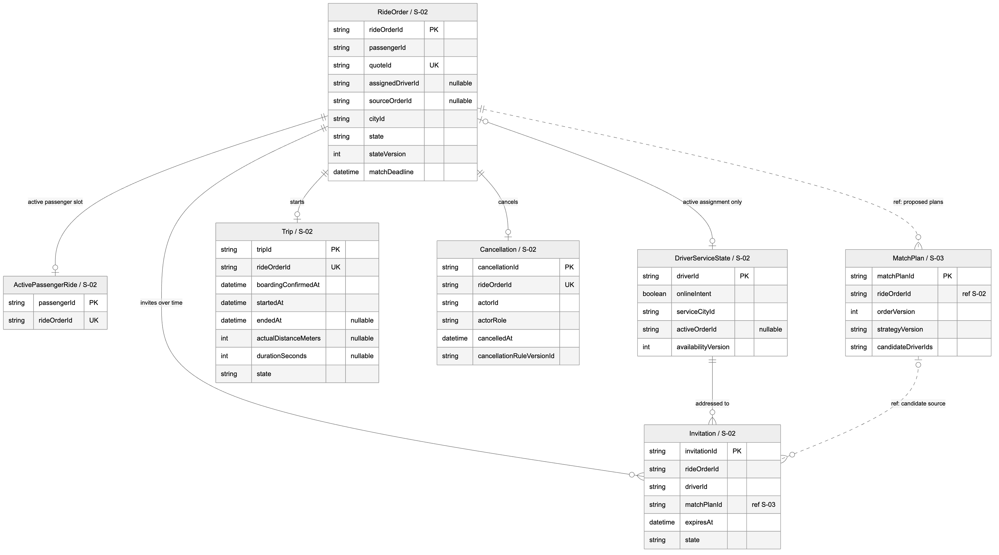
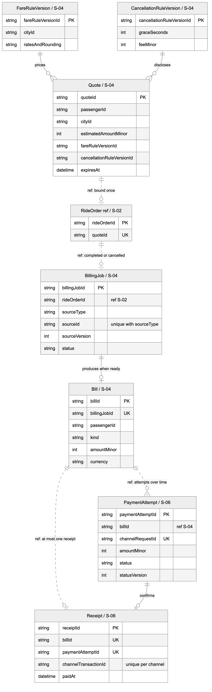
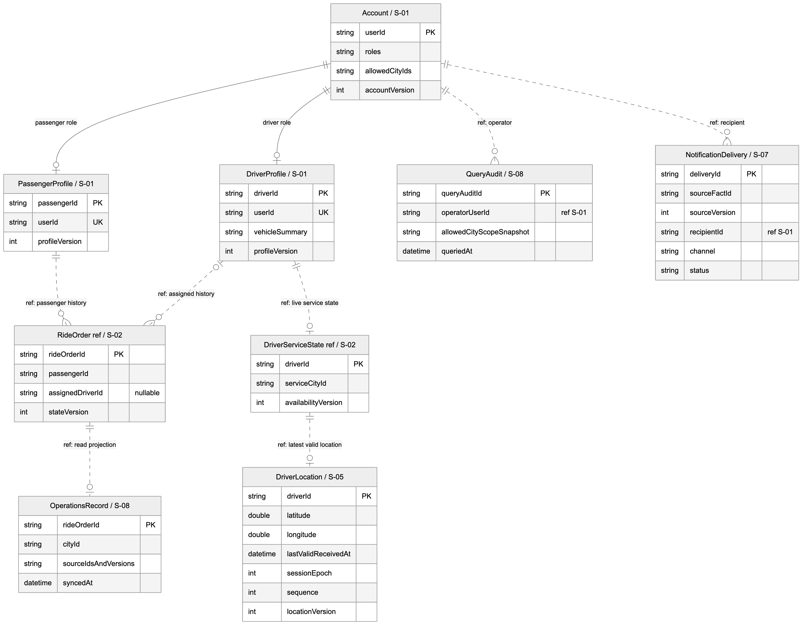
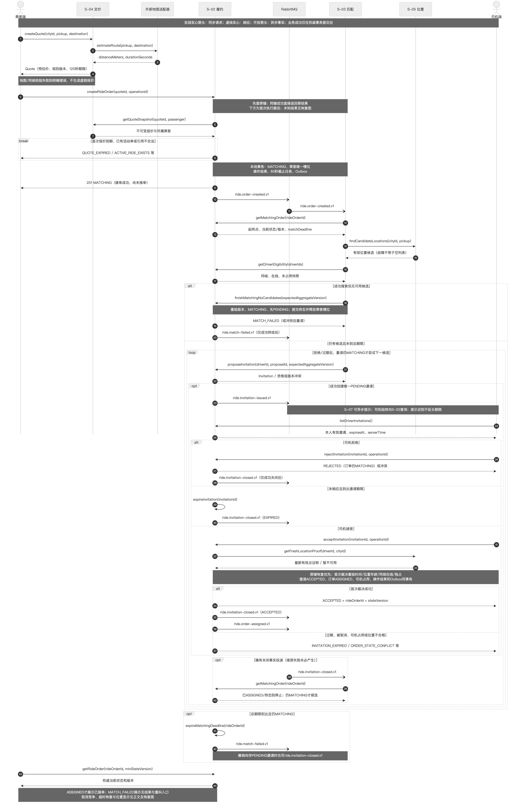
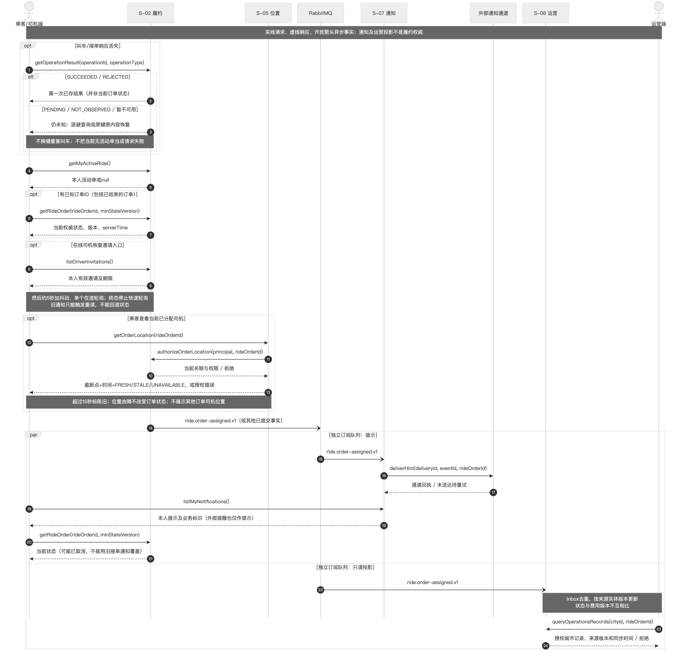
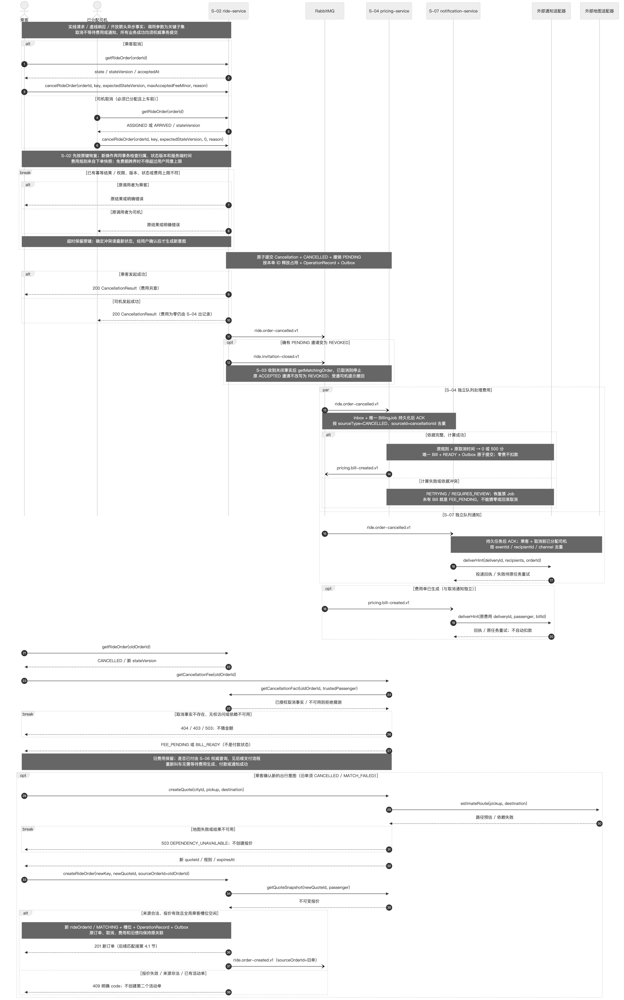
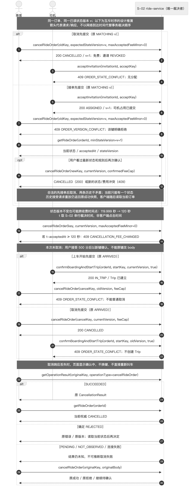
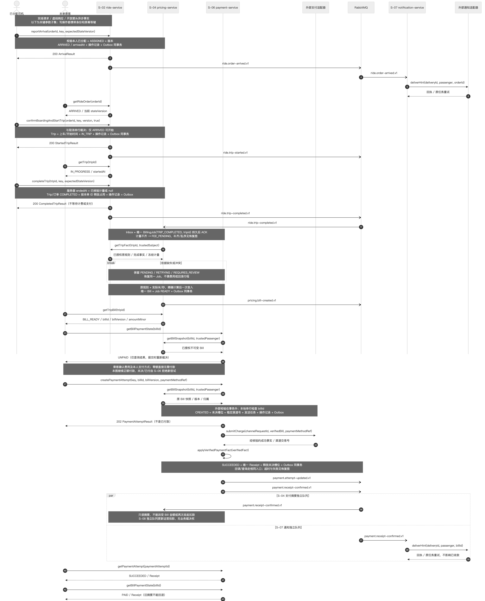
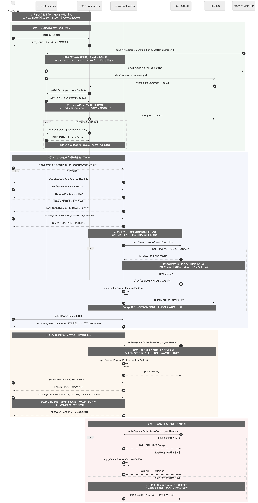
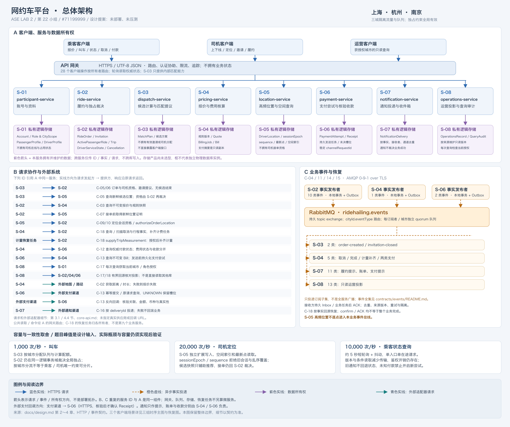

# 网约车平台微服务架构设计

> 状态：领域规则、八服务及数据归属、通信/事件、三条核心流程与恢复图、28 个客户端操作和 16 个内部操作均已整合；#71199999 已补总体架构图、图文追踪及交付导航。#71199997 的 57 项人工评审尚未执行，#71200000 已记录固定版本自动检查与辅助核对（见 [验收记录](validation.md)），正式人工验收仍待完成。本仓库是设计材料，没有实现业务服务或完成性能验证；合并与静态检查不等于全组确认。

依据：[Lab 2 作业要求](https://openmsg.yuque.com/openmsg/gp3cfs/eyuag71f933gx041)（核对日期：2026-10-26）。领域分析任务：[#71199988 Domain Analysis & Business Rules](https://devcloud.cn-north-4.huaweicloud.com/projectman/scrum/c1aa0a224dba4c2591226b87a5af9407/task/detail/71199988)，负责人：史冠航。

## 业务背景与规则提案

### 题目已给定的条件

| 项目 | 条件 |
| --- | --- |
| 使用方 | 乘客、司机、运营人员 |
| 运营城市 | 上海、杭州、南京；各城市高峰不同 |
| 峰值叫车提交 | 1,000 次/秒 |
| 峰值司机位置上报 | 20,000 条/秒 |
| 峰值乘客状态查询 | 10,000 次/秒 |
| 业务范围 | 身份与资料、报价与叫车、匹配与接单、位置与进度、接驾与上车、取消与重新叫车、行程与支付 |
| 设计交付 | 领域分析、服务与数据设计、通信设计、三条业务流程及接口/事件契约、整体架构图；无需业务代码或建表 SQL |

功能列表用于描述业务，不代表子域或服务划分。上述数字按平台总体峰值理解，不能当作三个城市各自的峰值，也不能默认流量在三城平均分配。若课程后续澄清口径，应更新本节及容量假设。

### 提案范围与决策状态

以下 BR 规则均为本组拟采用的设计选择，**不是题目额外规定，也尚未经全组确认**。它们为后续卡片提供可讨论的具体基线；评审调整时须同步数据模型、时序图及契约。

- 本轮设计聚焦即时、同城、一名乘客与一名司机的一单一车服务。预约、拼车、跨城、优惠券、现金支付、司机分账及自动退款不在本轮范围；异常争议保留运营查询和人工处理入口，不展开完整系统。
- 乘客、司机都可管理个人资料；司机可设置在线状态；运营人员查看被授权城市的业务记录。上述能力保留在范围内，不因本轮聚焦核心流程而删去。
- 文中的“订单”“行程”“费用单”“支付尝试”是分析用概念：分别指叫车履约承诺、实际运输过程、应付金额依据、一次向支付渠道请求付款的过程。不是已定稿的服务名、表名或接口字段；上下文差异由第 2 章进一步定义。

| 编号 | 事项 | 当前提案 | 主要影响 |
| --- | --- | --- | --- |
| BR-01 | 报价及计价 | 报价 120 秒有效；保留城市计价版本；预估金额与最终金额分开表达 | 报价、费用模型及叫车/账单契约 |
| BR-02 | 匹配与接单 | 同城在线且可服务的司机参与；总匹配时限 60 秒，单次邀请最多 15 秒；只能确认一个司机 | 候选、邀请、订单状态和超时分支 |
| BR-03 | 取消及竞争 | 上车前可取消；按权威状态的实际提交顺序判断冲突；乘客接单满 120 秒后取消收 5 元 | 取消规则版本、状态竞争、取消费用 |
| BR-04 | 重新叫车 | 旧单已取消或匹配失败才可重新叫车；新报价、新订单并保留来源关系 | 订单关联与旧单不可复活约束 |
| BR-05 | 接驾与行程 | 仅已分配司机可上报到达、确认上车并开始、结束行程；完成行程与付款结果分开 | 合法状态转换、角色权限、计费触发 |
| BR-06 | 支付与账单 | 每个费用单仅确认一次收款；结果未知时先查证，不能直接重付；失败可重试 | 费用单、支付尝试、回调和幂等 |
| BR-07 | 位置与进度 | 在线司机拟每 3 秒上报；超过 15 秒无有效新位置即标记陈旧；重连先恢复权威状态 | 位置新鲜度、候选资格、查询与恢复 |
| BR-08 | 重复、超时与不变量 | 同一业务操作可重试且不重复产生业务效果；传输超时不等同业务失败 | 全部写操作、冲突处理及后续契约 |
| BR-09 | 角色、城市与运营 | 按角色及订单归属授权；城市是业务归属维度；运营查询不直接改写履约事实 | 权限边界、城市规则和业务记录 |

#### BR-01：报价、计价与最终费用

1. 报价绑定乘客、运营城市和起终点，包含生成时间、到期时间、预估里程/时长、预估金额、币种 CNY 及计价规则版本。平台首次建立订单时必须满足当前时间小于到期时间；恰好到期或起终点改变时须重新报价。已成功叫车的同一操作重试按 BR-08 返回原结果，不因报价后来到期而重新建单或推翻成功结果。
2. 预估金额按所选城市、报价时段对应的规则版本计算，版本明确起步价、里程/时长单价及最低费用等参数。叫车成功后保留该版本，最终金额以实际有效里程/时长按同一版本计算，不在途中因高峰切换追溯改价。此处确定规则维度，不编造三城真实商业费率。
3. 金额用人民币分表示并非负，按所保留规则计算后统一四舍五入到分；客户端必须区分“预估”与“应付”。行程完成后生成行程费用单；缺少有效计费依据时显示费用待生成并重试，不能把预估金额或零当作最终费用。

#### BR-02：匹配资格、邀请与接单

1. 候选司机须属于当前城市、处于在线状态、位置有效且未被其他未结束订单占用。资料中的在线意愿、位置新鲜度和履约占用是不同条件：在线不意味着一定可接单，已离线也不会自动取消正在履约的订单。
2. 从叫车订单成功建立开始，匹配最多持续 60 秒。同一订单一次只保留一个有效邀请；单次有效期取“发出后 15 秒”和“总匹配截止时刻”的较早值。拒绝或邀请过期后，可在剩余时间内邀请下一候选人；无候选可立即返回匹配失败，总时限内无人成功接单则记为匹配失败。
3. 接单提交时重新检查邀请、订单状态、截止时间及司机占用。恰好到期视为失效；仅权威确认成功后才向乘客展示“已接单”。同一订单不能分给两名司机，同一司机不能同时履约两单；迟到、重复或失效邀请的接受不能重新打开终态订单。

#### BR-03：取消、费用及并发判定

1. 乘客可在待接单、已接单和已到达阶段申请取消；已分配司机可在已接单、已到达阶段申请取消。待接单时司机拒绝邀请不等于取消乘客订单。司机取消不向乘客收费；本轮不额外设计司机处罚体系。
2. 乘客在待接单阶段取消免费。接单后，按平台记录的接单时刻计算：经过时间小于 120 秒免费，大于或等于 120 秒收取 500 分；直到上车前适用。使用下单时已向乘客展示并保留的取消费规则版本，记录取消人、原因和判定时间，方便解释费用。司机到达与否不另改变这条简化费率。
3. 取消与接单同时到达时，以**权威订单状态转换的提交顺序**为准，而非客户端点击时间：取消先提交则后续接单失败且无取消费；接单先提交则取消基于已接单状态重新判定。取消与上车开始竞争时同理：取消先成功则不能开始，开始先成功则普通取消被拒绝，不把正在进行的行程倒退为已取消。
4. 一次成功取消只形成一个取消事实，并释放该单的司机占用；如需收费，为该取消事实建立一个费用单。费用生成或通知失败不撤销已取消状态，而是保留待处理结果并重试。重复取消返回已有结果，不重复收费或释放其他订单的占用。

#### BR-04：重新叫车与历史关联

旧单权威状态为已取消或匹配失败后，乘客才可重新发起同一出行意图。重新获取报价、创建新订单并记录来源旧单标识；新单重新匹配，不复用旧单的司机分配或状态。旧单、取消原因及应付费用保留，本轮允许旧取消费尚未支付时重新叫车，但旧债不抵消、不转嫁到新单。若取消请求仅超时且结果未知，先查询旧单，确认终态后再建新单。

#### BR-05：接驾、上车、结束及状态约束

下表是履约业务状态草案，供后续上下文与逻辑模型细化；实现时可以拆成订单状态与行程状态，但必须保持相同业务约束。

| 原状态 | 操作与发起者 | 成功后的状态/事实 | 关键约束 |
| --- | --- | --- | --- |
| 无订单 | 乘客确认有效报价并叫车 | 待接单 | 一名乘客最多一个未结束履约订单 |
| 待接单 | 受邀司机接单 | 已接单、确定司机 | BR-02；校验订单与司机的独占约束 |
| 待接单 | 匹配无结果或超时 | 匹配失败 | 后续邀请不能使该单重新成功 |
| 已接单 | 已分配司机上报到达上车点 | 已到达 | 保存到达时刻；重复上报不新增事实 |
| 已到达 | 已分配司机确认乘客已上车并开始行程 | 行程中；保存上车确认和开始时刻 | 本提案将上车确认与开始作为一次业务成功结果，不留可普通取消的上车后间隙 |
| 行程中 | 已分配司机确认结束 | 已完成；保存结束时刻及计费依据 | 结束不得早于开始；触发最终费用生成，不等待付款才结束行程 |
| 待接单/已接单/已到达 | 有权限的乘客或司机取消 | 已取消 | 角色和收费条件见 BR-03；待接单不接受司机取消 |

已取消、匹配失败和已完成均不允许重新接单、开始或再次产生结束效果。结束或取消后释放司机占用；迟到的旧单更新不得释放新单占用。乘客未付款、定位陈旧或通知失败不会直接修改已经提交的履约状态。已完成行程可同时存在费用待生成、待支付、支付处理中或已支付等独立费用状态。

#### BR-06：支付结果、重试与账单

1. 支付绑定一个明确的费用单（行程费用或取消费）及付款乘客，金额以该费用单为准，不接收客户端自行改价。支付成功依据经过验证的渠道结果或查询结果，客户端返回页不能单独作为成功证据。
2. 每次支付尝试有独立标识。超时或回调缺失为结果未知/处理中，先查询并沿用原尝试恢复，不能立即创建第二次扣款；渠道明确失败后才允许新尝试。一个费用单同一时间最多一个未决支付尝试，并最多确认一次收款。
3. 重复回调、主动查询与回调竞争均不能重复入账；迟到的失败不能覆盖已确认成功。账单查询返回费用和支付状态，失败后仍保留原应付费用及原因，不撤销已完成行程。本轮不展开退款、分账；若出现渠道结果互相矛盾，记录异常供人工核查，不伪报付款成功。

#### BR-07：位置新鲜度与客户端恢复

1. 在线司机拟每 3 秒提交位置；平台仅接受身份、位置值及时间合理的上报，并记录观测与接收时间及能判断先后的标识。乱序旧点不能覆盖新点，也不能刷新“最新位置”的新鲜度。以平台接收最新有效点后超过 15 秒为陈旧，不直接信任客户端时钟。
2. 陈旧位置不能用于新的司机匹配，乘客查看时应标明更新时间及位置暂不可用，不把旧位置伪装成实时位置。已在履约的司机暂时断网不会自动结束或取消行程，恢复后继续查询实际状态。
3. 刷新或重新连接后，客户端先读取订单/行程和费用的权威当前状态，再恢复增量更新；旧通知不能倒退已知状态。普通等待进度查询采用第 3 章的约 5 秒带抖动短轮询；本轮不采用 WebSocket 或 gRPC。这些周期是待评审参数，不是已验证的性能承诺。

#### BR-08：所有写操作共有的不变量

- 同一乘客最多一个待接单、已接单、已到达或行程中的订单；同一订单最多一个已确认司机；同一司机最多一个未结束的已分配订单。司机在结束/取消后可再次接单，未付费用不占用司机。
- 同一次叫车、接单、取消、上车开始、结束或支付重试，应携带可识别业务意图的标识。同一操作者、同类操作、同一标识且内容相同返回原结果；内容不同须明确冲突，不能悄悄当作新操作。下游重复处理也必须遵守不重复派单、计费、收款的约束。
- 平台完成权威业务状态变更后才能表示操作成功。客户端超时仅代表未收到结果；客户端先查询或以原标识重试，不自行推断失败、补偿或创建相反操作。历史终态不得被迟到消息覆盖；跨服务怎样保证这些约束由后续服务、模型和通信设计说明。

#### BR-09：资料、权限、城市与运营记录

乘客只修改本人资料、读取本人订单及账单；司机只修改本人资料和在线状态、响应给本人的有效邀请、处理分配给自己的订单，并提交本人的位置。运营人员按授权城市查询订单、派单、取消、费用和支付处理记录，记录查询操作，不通过“修改查询视图”更改业务事实。调用方身份不由请求体中任意填写的用户标识决定。

起点决定订单运营城市，本轮起终点须在同一支持城市；候选司机按该城市筛选。司机切换运营城市仅允许在离线且无未结束已分配订单时进行，再上线后参与新城市匹配。城市计价版本和有效时段可不同；已创建订单保留原城市与规则版本，不被后续资料或城市配置变化追溯改写。

## 一、领域分析（20 分）

### 1.1 从使用方需求提炼概念与能力

平台的业务目标是将乘客的一次出行需求转化为可履行、可计价、可支付且可追溯的服务。乘客关心结果和费用，司机关心有效工作分配与履约，运营人员关心可解释的记录。以下 R 编号对应题目中的业务范围；D 编号对应下一节子域，能力名称不代表微服务。

| 需求编号/使用方场景 | 要解决的业务问题 | 关键概念 | 业务能力 | 关联子域 | 关联规则 |
| --- | --- | --- | --- | --- | --- |
| R-01 乘客、司机管理资料，司机设置在线状态 | 区分操作身份、资料和参与接单资格 | 账户、角色、乘客资料、司机资料、在线意愿、运营城市 | 身份校验、本人资料维护、上下线及城市资格校验 | D-01、D-02 | BR-02、BR-09 |
| R-02 乘客选择起终点、获取报价、叫车并查等待进度 | 在费用预期明确的情况下建立一次出行承诺 | 起终点、城市、报价、计价版本、订单 | 预估计费、报价有效性判断、建立订单、读取等待状态 | D-03、D-05 | BR-01、BR-02、BR-08 |
| R-03 平台匹配，司机接受/拒绝，乘客查看结果 | 在有限时间内将合适供给分给需求，避免重复占用 | 候选司机、有效位置、邀请、截止时间、分配结果 | 筛选候选、派发邀请、处理拒绝/超时、确认唯一接单结果 | D-04 主导；协作 D-02、D-03、D-06、D-08 | BR-02、BR-03、BR-07、BR-08 |
| R-04 司机上报位置，乘客查看车辆及行程进度 | 区分最新位置与真实业务进度，断线后可恢复 | 位置观测、更新时间、订单/行程状态、接收者 | 校验上报、维护有效位置、提供空间检索、读取进度、推送提示 | D-06、D-03、D-08 | BR-07、BR-09 |
| R-05 司机到达并确认上车、开始行程 | 确保只有对应司机能推动合法履约步骤 | 到达事实、上车确认、行程、开始时刻 | 到达登记、角色/状态校验、确认上车并开始运输 | D-03 | BR-05、BR-08、BR-09 |
| R-06 乘客/司机取消，处理费用与通知后重新叫车 | 明确取消结果、冲突、费用以及新旧请求关系 | 取消申请/事实、取消费用单、来源订单、新订单 | 判定取消资格、结束旧单、生成取消费用、通知、创建关联新单 | D-03 主导；协作 D-04、D-05、D-07、D-08 | BR-03、BR-04、BR-06、BR-08 |
| R-07 司机结束行程，乘客支付并查询账单 | 将履约结果转成可核查的费用与收款结果 | 结束事实、实际里程/时长、费用单、支付尝试、账单 | 结束行程、最终计费、发起/查询支付、展示费用及支付状态 | D-03、D-05、D-07 | BR-01、BR-05、BR-06 |
| R-08 运营人员查看业务记录 | 回溯订单、派单及资金处理结果，解释异常 | 业务记录、城市权限、关联标识、查询留痕 | 按授权城市检索、关联业务过程、保留可追溯信息 | D-09 主导；引用 D-02～D-07 的事实 | BR-08、BR-09 |

### 1.2 子领域划分及分类依据

本提案把“可靠履约、提高匹配效率、提供可解释的定价”作为平台的核心价值；高频或重要并不自动意味着核心域。按共同业务问题和规则内聚性得到以下九个子域，后续限界上下文及服务可能合并或拆分，不要求九个微服务。

| 子域 | 业务范围及边界 | 关键概念与业务能力 | 类型 | 内聚性与分类依据 |
| --- | --- | --- | --- | --- |
| D-01 身份与访问控制 | 识别账户、角色和访问权限；不负责乘客偏好、司机在线意愿或订单状态 | 账户、身份凭据、角色、授权范围；登录身份识别及权限校验 | 通用域 | 身份认证与授权跨行业共用，适合复用成熟能力；重要性高但不形成网约车业务差异 |
| D-02 参与者资料与司机服务资格 | 维护乘客/司机业务资料、司机在线意愿及运营城市；不把在线状态等同于订单占用 | 乘客资料、司机资料、在线意愿、城市归属；资料管理、上下线和城市资格维护 | 支撑域 | 规则围绕参与出行服务的业务资料，具有行业特殊性；支撑匹配与履约，非本提案竞争重点 |
| D-03 出行订单与履约 | 管理从叫车到取消/完成的一次履约承诺及行程事实；不选择候选排序、不决定费率、不执行渠道扣款 | 订单、司机分配结果、取消事实、行程；建立订单、合法状态推进、终态查询及新旧订单关联 | 核心域 | 接单、取消、上车和结束共同约束同一承诺，集中分析可避免状态互相矛盾；可靠履约直接决定用户体验 |
| D-04 供需匹配与派单 | 根据城市、资格、有效位置和占用筛选并邀请司机；接单须与履约的唯一分配约束协调 | 候选、匹配轮次、邀请、截止时间；筛选/排序、派单、拒绝/超时处理及接单确认协作 | 核心域 | 围绕有限供给与实时需求的匹配效率和成功率内聚，算法与城市供需策略能形成平台差异 |
| D-05 定价与费用核算 | 负责城市计价规则、预估报价、行程/取消费用及费用说明；不自行判定订单取消成功，也不确认支付渠道收款 | 计价版本、报价、实际计费依据、费用单；预估计价、最终计费、取消费计算和费用查询 | 核心域 | 报价与结算共用计价依据；城市和时段策略影响供需和收入，且可解释、一致的费用是核心体验的一部分 |
| D-06 位置与空间信息 | 提供司机位置新鲜度和空间检索依据；不以 GPS 点直接认定接单、到达或结束行程 | 位置观测、时间/先后标识、空间索引；上报校验、最新位置维护和区域检索 | 支撑域 | 高更新频率和时效规则需要独立分析，但“获得位置”本身并非本提案的匹配竞争策略；地图/路径能力可引用外部能力 |
| D-07 支付渠道接入与收款记录 | 按既定费用单请求支付、确认渠道结果并提供收款状态；不重新计算行程费率 | 费用单引用、支付尝试、渠道流水、收款结果；支付请求、结果校验、查证及去重入账 | 通用域 | 支付状态处理和渠道接入广泛复用；本平台特有的费用判断留在 D-05，仍须设计可靠关联与幂等边界 |
| D-08 通知投递 | 将已确认业务结果传递给有权接收的客户端；不决定订单或支付最终状态 | 接收者、通知内容、投递结果；投递、失败重试与去重 | 通用域 | 消息投递是跨业务通用能力；具体业务事实由对应子域形成，通知成功不能替代业务成功 |
| D-09 运营业务查询与追溯 | 汇总授权城市内的业务记录并提供查询留痕；不绕过其他子域直接修订订单或收款事实 | 业务记录、关联标识、城市范围、查询留痕；跨过程检索与异常追溯 | 支撑域 | 查询视角贯穿出行链路，字段与规则有行业特点；支持运作与核查，不主导匹配和履约决策 |

### 1.3 边界取舍与业务协作

- **订单与行程先共同分析**：上车前取消、上车开始和结束必须表达同一履约承诺，故本章归 D-03；第 2 章可细分模型/服务，但必须解释状态一致性，不能按页面按钮直接拆分。
- **派单策略与订单承诺区分**：D-04 决定尝试哪些候选及何时换候选，D-03 表达是否已确认司机及是否已取消；两者协作不能对“已接单”给出两个可冲突的最终答案。
- **报价与最终计费归一类规则**：预估和结算都需要同一计价版本，归 D-05 有利于解释差额；支付是否成功是另一问题，由 D-07 处理，因此计价与渠道接入不混为一个子域。
- **位置、资料、通知不拥有履约结论**：D-02 提供资格，D-06 提供新鲜位置，D-08 投递业务结果；这些信息变化不会单独使订单接单、取消或完成。D-09 读取其他子域事实，聚合查询结果不能成为第二份可独立修改的权威事实。
- **技术设施不等同于业务子域**：网关、缓存、消息中间件、监控和地图供应商是后续架构选择，不作为额外业务子域凑数。本章没有确定数据库、协议、服务数量或部署拓扑。

### 1.4 三城市与峰值负载的设计输入

| 课程条件 | 对领域及后续设计的影响 | 后续需要说明的问题 |
| --- | --- | --- |
| 叫车提交峰值 1,000 次/秒 | D-03 的订单创建和 D-04 的匹配确认必须同时维护唯一性；重试不能放大成重复订单 | #71199989、#71199990 说明状态权威、并发冲突和重试边界 |
| 定位上报峰值 20,000 条/秒 | 定位写入频率约为叫车峰值的 20 倍；D-06 的新鲜度和空间检索需求与订单生命周期不同 | 说明定位独立扩展、旧点处理及陈旧位置对匹配的影响，不按每个点修改订单状态 |
| 状态查询峰值 10,000 次/秒 | 查询频率约为叫车峰值的 10 倍；乘客需要当前状态，运营可有不同的新鲜度需求 | 若用查询副本或缓存，说明可接受延迟、版本和冲突恢复；写入资格不能依据陈旧展示值 |
| 城市高峰不同 | 城市归属及费率版本进入业务规则；某城压力不应导致其他城业务错误 | 后续可比较按城市隔离/扩展的方案，说明热点城市、总体峰值和成本取舍 |

本章不假定三城平均各承担三分之一流量，也不假定三类峰值必然同时出现或完全错开。后续设计应分别讨论单城热点与多城重叠压力；3 秒上报、15 秒陈旧阈值及 5 秒回退查询须结合目标评审，不能从这些参数或峰值直接声称系统已满足性能要求。

### 1.5 规则推演与任务交接

以下仅是文档的一致性推演，供 QA 转成检查项；没有运行中的业务系统，**不是测试通过记录**。

| 场景 | 按本提案应得到的业务结果 | 对应规则 |
| --- | --- | --- |
| 报价生成后恰好第 120 秒首次提交叫车 | 报价已过期，要求重新报价，不能建立新订单 | BR-01 |
| 邀请到期或总匹配时限到达后才接单 | 该接受无效，不能覆盖匹配失败或已取消状态 | BR-02、BR-08 |
| 同一司机收到两个订单的接单处理，或同一订单竞争两个司机 | 只能形成一个符合独占约束的确认结果，其余返回冲突/失效 | BR-02、BR-08 |
| 取消先提交，接单后到 | 原单已取消，接单失败，乘客无取消费 | BR-03 |
| 接单后第 119 秒与第 120 秒分别发起乘客取消 | 在仍可取消前提下，前者免费，后者 500 分；判断使用平台时间 | BR-03 |
| 取消与上车开始竞争，开始先提交 | 普通取消被拒绝，保留行程中状态，不能按取消计费 | BR-03、BR-05 |
| 旧单取消结果未知时点击重新叫车 | 先查询原结果；确认已取消后才新报价、新订单，旧费用仍保留 | BR-04、BR-08 |
| 行程结束后计费暂时失败 | 行程已完成、司机释放，费用待生成；不猜金额、不重新结束行程 | BR-01、BR-05 |
| 支付请求超时后重试，随后收到重复成功与迟到失败 | 先查证/恢复原尝试，成功仅入账一次，迟到失败不能覆盖成功 | BR-06、BR-08 |
| 定位超过 15 秒未更新、或断线后收到旧通知 | 显示陈旧，不参与新匹配；先恢复当前业务状态，不回退已提交状态 | BR-07 |

| 后续卡片 | 负责人 | 本卡提供的输入与需确认内容 |
| --- | --- | --- |
| #71199989 Service Boundaries & Data Ownership | 李全昊 | R/D/BR 清单；落实上下文、术语、权威模型、独占约束及状态转换 |
| #71199990 Service Communication & Events | 刘子扬 | 子域协作、峰值及结果未知规则；解释通信、时效和幂等的具体保证 |
| #71199991 Client Scenarios & Booking Flow、#71199996 Core API Contracts | 刘乐翔 | 报价/等待/接单展示语义；将规则映射到输入输出、错误和恢复方式 |
| #71199994 Cancellation & Rebooking Flow | 刘子扬 | 取消资格、费用阈值、竞争判定、新旧订单关联及通知失败处理 |
| #71199995 Pickup, Trip & Payment Flow | 李全昊 | 上车开始、结束与费用/支付分离；补充真实接口/事件及异常时序 |
| #71199997 Design Review Plan | 杨润东 | 需求覆盖和规则推演；检查边界条件、遗漏与矛盾，不提前标记已执行 |

本卡第 1 章及规则提案已编写；前端、另一位后端和 QA 的交叉确认仍待进行。评审重点是取消费与时限是否合理、上车开始的业务边界、重新叫车与欠费关系、重复/超时下的不变量；完成确认后在文末评审记录和卡片中填写真实结论与 PR 链接。

## 二、微服务划分与数据归属（30 分）

本章对应 [#71199989 Service Boundaries & Data Ownership](https://devcloud.cn-north-4.huaweicloud.com/projectman/scrum/c1aa0a224dba4c2591226b87a5af9407/task/detail/71199989)。以下为基于 BR-01～BR-09 的设计提案。它确定后续流程共同使用的名字、状态与数据所有者；尚未实现服务，也不表示已完成跨成员评审或性能验证。

### 2.1 限界上下文与统一语言

子域回答“解决什么业务问题”，上下文限定模型和术语的含义，服务则是独立部署与数据维护的边界。本方案保留九个上下文，合并身份和资料的部署单元，得到八个业务服务。D-02 的动态服务状态、D-04 的有效邀请与最终接单判定进入履约上下文，原因是它们参与同一个独占分配约束；不能机械地把九个子域转换成九个数据库。

| 上下文 | 子域映射 | 业务范围与术语定义 | 同名差异与关联 |
| --- | --- | --- | --- |
| C-01 身份访问 | D-01 | Account 表示登录主体；Role/CityScope 表示身份角色和运营查询范围；身份验证不等于某张订单的操作授权 | userId 是身份 ID，不是订单或司机分配 ID；订单所有权仍由履约检查 |
| C-02 参与者资料 | D-02 的资料部分 | PassengerProfile、DriverProfile 表示业务资料；司机资料含车辆说明及所属账户，不持有当前订单 | “司机”是长期业务身份；在线意愿、服务城市、是否占用由 C-03 的 DriverServiceState 表达，资料中的展示副本不能用于派单决策 |
| C-03 出行履约 | D-03；D-02 的动态服务资格；D-04 的有效邀请/接单约束 | RideOrder 是一次出行承诺；Trip 是实际运输事实；Invitation 是有明确对象和期限的接单资格；DriverServiceState 是在线意愿、当前服务城市和占用的权威记录 | “已接单”只指 RideOrder 已确认司机；候选入选、邀请送达或客户端点接受均不等于接单成功。履约“完成”不等于支付完成 |
| C-04 匹配策略 | D-04 的候选搜索与排序 | MatchPlan 表示某次基于位置和资格快照得到的候选方案；候选分数与推荐顺序是可替换的策略结果 | “可用司机”是候选时刻的估计，提交接单仍须 C-03 重验；MatchPlan 不拥有有效邀请或订单状态 |
| C-05 定价核算 | D-05 | FareRuleVersion、CancellationRuleVersion 是不可变规则版本；Quote 是限时估价；Bill 是可解释的应付费用；BillingJob 是尚未成功产出费用单的任务 | “报价”不是最终账单；“取消费”由已确认取消事实计算，不能据费用生成失败推翻取消；Bill 不把支付摘要当作渠道收款权威 |
| C-06 位置空间 | D-06 | DriverLocation 是最新有效位置观测；新鲜度以最新有效点的服务端接收时间判断；区域检索返回位置与版本 | “在线”不能由 GPS 存在推断；“位置更新”不是到达/上车/结束的履约状态变化 |
| C-07 支付收款 | D-07 | PaymentAttempt 是一次渠道付款尝试；Receipt 是确认收款记录；渠道交易号关联外部结果 | 支付渠道所称的“订单号”映射 paymentAttemptId，不是 rideOrderId；已付款由 Receipt 证明，不由前端返回页或费用单缓存证明 |
| C-08 通知投递 | D-08 | NotificationDelivery 表示向某个有权接收者投递一个事实的尝试与结果 | “已送达”只说明投递，不改变订单/费用/支付状态；业务通知是事实副本 |
| C-09 运营查询 | D-09 | OperationsRecord 是按订单串联的查询投影，QueryAudit 是查询留痕 | 运营页的“订单”“账单”是带来源版本的查询视图；无权直接写回履约、计价或收款数据 |

服务名、上下文编号和下文实体名作为 #71199990、#71199991、#71199994、#71199995、#71199996 的共同基线。具体接口路径、事件名称、协议和重试参数已在第 3 章与第 4.4 节及所链接契约中补齐；调整时同步更新模型、图和契约。静态对照不代替真实组内确认。

### 2.2 微服务职责、依赖及拆分依据

| ID / 服务名 | 上下文 | 职责及对外能力 | 主要依赖（业务方向） | 拆分/合并理由 |
| --- | --- | --- | --- | --- |
| S-01 `participant-service` | C-01、C-02 | 账户/角色、乘客和司机资料、身份关联、运营城市授权范围 | 可复用成熟身份组件；不依赖订单库 | 身份与资料变更频率和负载接近，小组先合并部署减少配置和运维负担；内部仍分模块，不复制身份验证方案到每个业务服务 |
| S-02 `ride-service` | C-03 | 叫车、司机上下线/离线换城、有效邀请、接单、到达、上车开始、结束、取消、履约查询 | S-01 提供身份/资料；S-04 提供不可变报价及规则快照；S-05 提供新鲜位置证明；S-03 提议候选 | 把订单、行程、司机占用与有效邀请放在同一事务边界，直接维护一单一司机、一司机一单；避免拆成“接单服务”“取消服务”后无法共同裁决状态竞争 |
| S-03 `dispatch-service` | C-04 | 搜索/排序候选，产生 MatchPlan，收到拒绝/过期/冲突后选择下一候选 | 读取 S-02 的订单/服务资格，查询 S-05 的空间候选；向 S-02 提议邀请 | 排序策略变化快、城市差异大，可单独发布与扩展；不承担最终确认，重启或重复执行不会获得第二份分配权 |
| S-04 `pricing-service` | C-05 | 城市规则版本、预估报价、取消费、最终行程费用与费用查询 | 地图/路径能力用于预估；S-02 提供不可变取消或行程结束事实；S-06 提供收款查询结果 | 报价与结算共用计价版本和规则，合并避免漂移；城市/时段规则比履约状态机更常变化，独立发布；不承接渠道回调 |
| S-05 `location-service` | C-06 | 司机位置上报、有效性/乱序判断、最新点与空间检索 | S-01 身份；S-02 提供服务城市和可访问订单关联 | 20,000 条/秒位置更新显著高于叫车流量，独立写入和空间索引扩展，避免每个 GPS 点锁订单；故障只降低候选/位置能力，不删除履约事实 |
| S-06 `payment-service` | C-07 | 建立/恢复支付尝试、校验渠道回调、查证未知结果、唯一收款记录 | S-04 提供权威费用及付款人；外部支付渠道 | 外部渠道失败模式、安全凭据、对账运维和发布时间不同；收款处理独立于计价，支付不可用不阻止行程结束或旧取消单后重新叫车 |
| S-07 `notification-service` | C-08 | 投递业务结果、失败重试、记录投递状态 | 其他服务的已提交事实和接收者授权信息；客户端/外部通知通道 | 客户端连接及重试流量可单独伸缩；通知故障不能拖住核心状态事务；通知不负责业务补偿 |
| S-08 `operations-service` | C-09 | 按城市/订单关联只读业务记录、标注延迟、查询审计 | S-01 授权范围；S-02～S-06 业务事实/按需查询 | 跨过程查询与面向乘客的实时状态访问形态不同；独立投影减少运营检索对写路径的干扰，运维人员也不能跨库改业务数据 |

**部署与容量取舍。** 八个服务是设计边界，当前仍用一个仓库交付，不要求八个仓库或八位负责人。身份/资料合并，订单/行程/分配约束合并，报价/最终计费合并；位置、匹配和支付因负载、变化频率或故障隔离独立。独立部署增加配置、监控、跨服务故障排查和版本兼容成本，需共享追踪 ID、契约检查和告警约定，不能把拆得更多当成设计目标。

- 叫车峰值 1,000 次/秒：S-02 的写入首先受独占约束和事务时延约束，S-03 可按城市扩展候选计算。避免把 S-04/S-05 的远程等待放进持锁事务；先取得版本化的不可变输入/时效证明，再在事务中检查其有效期和本地权威状态。
- 定位峰值 20,000 条/秒：S-05 按 driverId、城市空间区域组织写入/索引；有效点仅在位置域更新，不按点更新 RideOrder 或生成全量运营投影。本卡不决定存储产品、分片数或压测结论。
- 状态查询峰值 10,000 次/秒：S-02 可使用只读缓存/投影削峰，返回 `stateVersion`、来源和更新时间；写操作及“刚操作后的确认”回源权威状态。客户端带已见版本，缓存低于该版本时回源，不回退页面；缓存不可用可限流降级，不能伪造值。
- 三城高峰不平均：部署层可隔离城市工作队列、限流和候选计算配额，保留热点城及多城同时高峰的容量预算。**本提案不按城市拆开 S-02 的乘客/司机独占记录**：它们以全局 passengerId/driverId 为键，先保持一个逻辑事务权威，以防换城后双重占用。若未来分库，必须另行设计全局资格迁移/保留机制，不能只加 cityId 就宣称约束仍成立。
- 团队分工：李全昊维护本章及履约/数据口径，刘子扬维护通信/事件及取消竞争说明，刘乐翔维护客户端与接口，杨润东交叉检查，史冠航整合。负责人是文档协作关系，不意味着一人只能修改或运维一个服务。

### 2.3 逻辑数据模型与权威所有权

#### 2.3.1 公共约定

- 业务 ID 使用不带展示含义的全局唯一字符串，实体各有自己的 ID；账户通过 userId 关联乘客/司机资料。所有外部引用在业务入口校验存在性、角色和所有权，不以知道 ID 代替授权。
- 金额为非负整数分、币种 CNY；时间为服务端 UTC 时刻，接口使用 RFC 3339 格式；距离为整数米，时长为整数秒。城市使用受支持 cityId，坐标在 HTTP 契约中统一为 WGS84，由地图适配器转换供应商坐标。
- 状态变更带单调递增的 `stateVersion`，资料/位置等分别有 `profileVersion` / `locationVersion`。不同实体的版本不可互相比较；跨服务引用不是跨库外键，也不允许跨库联表写入。
- 不可变快照保留来源 ID、规则版本、产生时间及必要字段；可刷新查询投影保留来源服务/实体 ID、来源版本和同步时间。快照用于解释当时决定，投影用于展示，不混用。
- 图内列出关键字段，完整业务约束以下表和第 2.4 节为准；这些是逻辑模型，不是建表 SQL。图中实体后标记 `S-xx` 表示所有者；“ref”关系是跨服务 ID 引用，图上的关系线不表示数据库事务或网络调用。

#### 2.3.2 履约与分配模型

[可编辑图源](diagrams/data-model-ride.mmd)。Trip 与 Cancellation 互斥：一次取消或未匹配成功的订单没有 Trip；只有成功上车开始才创建 Trip。图中的 0..1 是结构基数，状态约束另行限制组合。

| 实体 / 权威服务 | ID、关键字段及关系 | 状态与约束 |
| --- | --- | --- |
| RideOrder / S-02 | rideOrderId；passengerId；cityId；quoteId；可空 assignedDriverId/sourceOrderId；起终点；fareRuleVersionId/cancellationRuleVersionId 及必要快照；createdAt/matchDeadline/acceptedAt/arrivedAt；state/stateVersion | `MATCHING → ASSIGNED → ARRIVED → IN_TRIP → COMPLETED`；也可按规则进入 `CANCELLED` / `MATCH_FAILED`。quoteId 最多绑定一个订单；sourceOrderId 必须是同乘客已取消/匹配失败的旧单；终态不可复活 |
| ActivePassengerRide / S-02 | passengerId（唯一键）；rideOrderId（唯一引用）；创建时间 | 仅为四种未结束状态保留。建单、进入终态时同 RideOrder 原子建立/删除；跨城市也只有一条 |
| DriverServiceState / S-02 | driverId（唯一键）；onlineIntent；serviceCityId；可空 activeOrderId；availabilityVersion；changedAt | 在线意愿不等于空闲；接单同时设置 activeOrderId，取消/完成仅在其仍等于该订单 ID 时清除。换城只允许离线且无占用；下线不会取消已有订单 |
| Invitation / S-02 | invitationId；rideOrderId；driverId；可空 matchPlanId；createdAt/expiresAt；state | `PENDING → ACCEPTED/REJECTED/EXPIRED/REVOKED`，终态不可逆；同订单最多一个 PENDING。expiresAt = min(创建时刻+15 秒, matchDeadline)；接受成功必须与订单分配、司机占用同事务 |
| Trip / S-02 | tripId；rideOrderId（唯一）；driverId；boardingConfirmedAt/startedAt/endedAt；actualDistanceMeters/durationSeconds；meteringSource/measurementVersion；state | `IN_PROGRESS → COMPLETED`。上车确认、Trip 建立和订单进入 IN_TRIP 同事务；结束与订单完成同事务。计费依据缺失不能填 0；可在结束后补齐经核对的依据并留版本，首次成功生成费用单后不得悄悄改变依据 |
| Cancellation / S-02 | cancellationId；rideOrderId（唯一）；actorId/actorRole/reason；cancelledAt；acceptedAt 快照；cancellationRuleVersionId 及规则快照 | 只记录成功取消事实；存下可解释费用的时刻和版本，不存另一份可独立修改的订单状态；与订单 CANCELLED 及占用释放同事务 |
| MatchPlan / S-03 | matchPlanId；rideOrderId；cityId；strategyVersion；基于的 orderVersion；候选 driverId 及来源位置/资格版本；createdAt；候选排序/提议结果 | 候选方案是有时效的工作记录；提议被接受不等于司机已接单。过时方案只能丢弃或重算，不能更新 RideOrder；即使重复提议，S-02 仍只创建一个有效邀请 |

#### 2.3.3 定价与收款模型

[可编辑图源](diagrams/data-model-billing.mmd)。为可读性，图中 BillingJob 的来源只画订单关联，具体来源为 Trip 完成事实或 Cancellation；费用单与支付尝试是一对多，收款记录最多一个。

| 实体 / 权威服务 | ID、关键字段及关系 | 状态与约束 |
| --- | --- | --- |
| FareRuleVersion / S-04 | fareRuleVersionId；cityId；适用时段；起步价、每米/每秒计价参数、最低费；roundingPolicy；生效范围 | 发布后的版本不可修改；新价格发布新版本。Quote 选定版本在该订单最终计费时保持不变 |
| CancellationRuleVersion / S-04 | cancellationRuleVersionId；cityId；graceSeconds=120；feeMinor=500；适用取消者/阶段 | 叫车前展示、下单时由 S-02 保存快照；不随最新规则覆盖旧单；待接单/司机取消为 0，乘客接单满 120 秒且上车前为 500 分 |
| Quote / S-04 | quoteId；passengerId；cityId；起终点；estimatedDistanceMeters/estimatedDurationSeconds/estimatedAmountMinor；currency；两个 ruleVersionId；createdAt/expiresAt | 生成后不可变；有效性由比较时间决定，不依赖清理任务准时运行。S-02 保存引用和必要快照，独立维护 quoteId 已绑定订单的唯一性 |
| BillingJob / S-04 | billingJobId；rideOrderId；sourceType=`TRIP_COMPLETED` 或 `CANCELLED`；sourceId/sourceVersion；计价版本及事实快照；attemptCount/lastError/nextRetryAt | 按 `(sourceType, sourceId)` 唯一。`PENDING/RETRYING/READY/REQUIRES_REVIEW`；缺计费依据留待处理，不能生成猜测金额；依据补齐后按来源版本恢复同一任务 |
| Bill / S-04 | billId；billVersion（固定版本）；billingJobId（唯一）；rideOrderId；passengerId；kind=`TRIP_FARE/CANCELLATION_FEE`；amountMinor/currency；规则、距离/时长或取消时间快照；明细；createdAt | 只在金额确定后产生，已生成金额不可变。0 分也可形成可解释费用记录，但标为无需支付，不创建支付尝试；大于 0 的支付结果来自 S-06，不把支付摘要当作本地业务事实 |
| PaymentAttempt / S-06 | paymentAttemptId；billId；passengerId；权威费用快照及 billVersion；amountMinor/currency；channelRequestId；可空 channelTransactionId；status/statusVersion；requestedAt/lastCheckedAt | `CREATED → PROCESSING/UNKNOWN → SUCCEEDED/FAILED_FINAL`；CREATED/PROCESSING/UNKNOWN 都算未决；同 billId 最多一个未决尝试。FAILED_FINAL 仅表示渠道已确认且不可再成功的失败，不由网络超时产生 |
| Receipt / S-06 | receiptId；billId（唯一）；paymentAttemptId（唯一）；channelTransactionId（渠道内唯一）；amountMinor/currency；paidAt；verifiedSource | 仅凭已验真的成功结果创建；与对应尝试 SUCCEEDED 同事务；重复回调/查询不得重复确认。确认成功不可被迟到失败覆盖 |

Bill 查询的展示状态由明确事实组合得到：无 Bill 时为 `FEE_PENDING`；0 分为 `NO_PAYMENT_REQUIRED`；正金额且无 Receipt/未决尝试为 `UNPAID`；有未决尝试为 `PAYMENT_PENDING`；有有效 Receipt 为 `PAID`。S-06 不可用或投影未追上时显示支付状态未知/更新时间，不把它等同 UNPAID 并引导再次扣款。

#### 2.3.4 参与者、位置与只读投影

[可编辑图源](diagrams/data-model-support.mmd)。只读副本保留业务 ID，不复制密码或渠道密钥；联系方式等仅向有业务权限的查询返回必要内容。

| 实体 / 权威服务 | ID、关键字段及关系 | 状态/约束、引用方 |
| --- | --- | --- |
| Account / S-01 | userId；认证主体引用；roles；运营 allowedCityIds；accountVersion | 认证组件管理凭据，本业务模型不重复保存明文密码。角色和城市范围用于身份授权；订单内归属检查由 S-02 完成 |
| PassengerProfile / S-01 | passengerId；userId（唯一）；displayName/contactReference；profileVersion | S-02、S-04、S-06 引用 passengerId；展示仅缓存必要资料，不以缓存允许越权操作 |
| DriverProfile / S-01 | driverId；userId（唯一）；displayName/contactReference/vehicleSummary；profileVersion | S-02 的 DriverServiceState 通过 driverId 关联；资料不再定义 online、busy 或 activeOrderId |
| DriverLocation / S-05 | driverId（唯一）；经纬度/坐标系；观测时间 observedAt；服务端 lastValidReceivedAt；sessionEpoch/sequence；locationVersion；serviceCityId 来源版本 | 只用有效新点更新当前位置与新鲜度；同会话递增 sequence、重连使用服务端发放的新 epoch，旧会话/旧序号不能覆盖。超过 15 秒陈旧；版本判定不能只用客户端时间 |
| NotificationDelivery / S-07 | deliveryId；sourceFactId/sourceService/sourceVersion；recipientId（S-01 userId）；channel；payloadReference；attemptCount/lastError | `(sourceFactId, recipientId, channel)` 去重；PENDING/SENT/FAILED_RETRYABLE。投递重复不得变成重新执行原业务操作 |
| OperationsRecord / S-08 | rideOrderId；cityId；passengerId/driverId；履约/费用/支付摘要；各来源 ID/version；sourceUpdatedAt/syncedAt | 只读的多来源投影，按每个来源分别判新旧，不伪造一个跨服务统一版本；可显示部分数据未同步并按需回源 |
| QueryAudit / S-08 | queryAuditId；operatorUserId；allowedCityScopeSnapshot；查询条件摘要；queriedAt；结果范围 | 只追加必要查询留痕；查询先校验授权城市，不因知道订单 ID 绕过；无直接修改源服务数据的入口 |
| OperationRecord / 各写操作所属服务 | `(actorId, operationType, idempotencyKey)`；requestFingerprint；targetId；resultReference；createdAt | 由处理操作的权威服务保存；同键同内容返回原结果，同键异内容冲突。持久化业务结果与业务状态同事务；短期缓存失效也不能使业务唯一约束失效，保留期由契约另定 |

### 2.4 不变量、状态迁移与一致性边界

#### 2.4.1 履约使用一个本地事务裁决

S-02 私有的数据存储共同维护 RideOrder、ActivePassengerRide、DriverServiceState、Invitation、Trip、Cancellation 及自身 OperationRecord。模型层要求事务与唯一约束，具体数据库产品后续选择；不依靠前端禁用按钮、缓存锁或“先查询再单独写入”保证独占。

| 操作 / 发起者 | 允许原状态与事务内检查 | 原子写入及失败结果 |
| --- | --- | --- |
| 首次叫车 / 乘客 | 先取 S-04 权威 Quote/规则；事务中验证用户/城市/起终点匹配、当前时间 `< expiresAt`、无活动订单；重叫时检查来源旧单归属及终态 | 建 RideOrder=MATCHING、ActivePassengerRide、OperationRecord；quoteId 唯一。并发重复或已有活动单明确冲突；原成功请求重放先返回原单，不重新判过期 |
| 上下线或换城 / 司机 | 司机操作自身 DriverServiceState；换城要求原来离线且 activeOrderId 为空；允许城市取三城范围 | 同一司机记录串行推进 availabilityVersion；下线只改变意愿，保留占用。与接单竞争时用同一记录的事务顺序判定 |
| 发邀请 / S-03 提议、S-02 执行 | MATCHING、未过 matchDeadline、当前无有效 PENDING；提议版本/司机城市和资格适用 | 将旧过期邀请终结后建立唯一 PENDING；到期判断看时刻而非只看状态标签。重复提议不得同时留两个邀请 |
| 接受邀请 / 受邀司机 | 先取 S-05 的位置版本/接收时间证明；事务内按决策时刻检查位置证明的城市与服务城市一致、年龄 `≤15 秒`、邀请为该司机且未过期、MATCHING、未过总期限、在线/同城/无占用 | 将邀请 ACCEPTED、订单 ASSIGNED/assignedDriverId/acceptedAt、司机 activeOrderId 和 OperationRecord 一起提交。所有权检查失败或并发冲突不能局部成功 |
| 拒绝/邀请到期 / 受邀司机或到期处理 | PENDING 且订单仍 MATCHING；总期限到达时不再换候选 | 关闭邀请；若尚可继续则请求新方案，若总期限到或确定无候选则将订单 MATCH_FAILED 并释放乘客占用。S-02 自己负责最终截止判断，不能依赖 S-03 一直在线 |
| 到达 / 已分配司机 | ASSIGNED 且 driverId 与订单一致 | 更新 ARRIVED、arrivedAt、stateVersion；重复同操作返回原结果，不重复产生事实 |
| 上车开始 / 已分配司机 | ARRIVED，订单及占用仍一致 | 建 Trip=IN_PROGRESS，保存 boardingConfirmedAt/startedAt，并将订单置 IN_TRIP；取消竞争只可能有一个提交成功 |
| 取消 / 所属乘客或已分配司机 | 乘客可 MATCHING/ASSIGNED/ARRIVED；司机仅 ASSIGNED/ARRIVED；记录事务序列中的决定时刻与 acceptedAt | 建唯一 Cancellation、订单 CANCELLED，撤销 PENDING 邀请，删除该单乘客占用，并按 activeOrderId 条件释放司机。费用任务/通知随后恢复，不回滚已取消事实 |
| 结束 / 已分配司机 | IN_TRIP，计时合法，订单/Trip/占用关系一致 | Trip 与订单 COMPLETED，保存已取得的计费依据或缺失状态、释放该单占用。通知计价恢复处理；费用失败不改变履约终态 |

每个事务有固定锁顺序或等价的冲突检测及有限重试；对外只在提交成功后报告成功。以 S-02 串行裁决点的服务端时间检查期限/费用边界并持久化，不能拿客户端点击时间覆盖顺序。并发接单、取消、开始互相冲突时，失败方读取最新权威状态后返回明确原因；运输超时返回结果未知并按原幂等键恢复。

**位置证明的时效限制。** S-02 在接单事务前请求 S-05 的有效点证明，并在事务内重验其年龄；证明过旧或位置服务不可用则不能新接单。证明不是跨服务全局锁，S-05 随后的新点可能更新位置，但不能改写已经确认的分配。司机城市、在线和占用在 S-02 本地最终校验，S-03 的资格副本永远不能直接确认接单。

#### 2.4.2 跨服务边界不假设分布式原子提交

- **报价到订单**：S-04 保存不可变 Quote，S-02 保存其 ID 和快照并独占绑定 quoteId。报价过期由 S-02 的首次建单决策检查；报价查询失败时不猜金额或创建新订单。已建单的响应丢失依靠 S-02 OperationRecord 恢复。
- **取消/结束到费用**：S-02 的事务保存业务事实和待投递记录，异步传递采用第 3 章确定的 RabbitMQ 业务事件。S-04 以 `(sourceType, sourceId)` 去重建立 BillingJob，成功时原子写唯一 Bill 并完成任务；计费依据未齐则等待/重试并公开 FEE_PENDING。即使投递重复或服务重启，也不再取消/结束一次。S-02 的待投递记录与源事实原子保存；消费者保存已处理标识与业务写入，失败可重放或按源事实对账补齐，不能仅“发消息后希望成功”。
- **支付与费用**：发起新尝试前 S-06 读取 S-04 权威 Bill，核对乘客、正金额、币种及不可变版本；S-06 本地事务锁定 billId 的支付槽位，检查无 Receipt、无未决尝试后创建 PaymentAttempt。先持久化渠道请求 ID 再调用外部渠道，同一尝试所有发送/重试沿用该 ID。结果 UNKNOWN 时先查询原尝试，不能创建第二笔。
- **收款确认**：S-06 验证渠道结果关联、金额、币种与真实性，再将尝试成功和 Receipt 一起提交。对外渠道需支持幂等请求/按原请求查询以及明确终态；只有可信的 FAILED_FINAL 才释放槽位供新尝试。若渠道不具备这些保证，改为等待人工核对，不能用本地幂等宣称外部扣款天然恰好一次。矛盾结果或额外成功流水记录为异常待核对，不改掉已有 Receipt 或伪报新的成功。
- **无费用与失败展示**：0 分 Bill 不调用渠道；未生成费用、支付未知、通知失败分别显示，不伪装为费用 0、支付失败或行程未完成。S-04 的支付展示副本可延迟，真正再次付款资格始终由 S-06 权威判定。

### 2.5 引用、副本更新与读取约定

| 数据流 / 副本使用方 | 权威来源与引用方式 | 更新、延迟及冲突处理 |
| --- | --- | --- |
| 身份与资料 → 各业务服务 | S-01 的 userId/passengerId/driverId；必要 profileVersion | 身份授权按有效凭据及权限检查；资料展示可缓存，变更按版本刷新。运营城市权限必须在每次查询校验，权限检查失败不得使用旧展示缓存放行 |
| Quote/规则 → S-02 | S-04 quoteId 和不可变规则版本；订单保留必要快照 | 创建时读取并校验，快照此后不随最新价格变化；后续计费按保留版本重现，而非读取最新费率 |
| 订单/司机服务状态 → S-03 | S-02 rideOrderId/stateVersion、driverId/availabilityVersion | 通知或按需查询更新候选视图；过时方案可重算。最终邀请/接单都回到 S-02 验证，副本延迟最多影响效率，不能放宽唯一约束 |
| 最新位置 → S-03 / 已授权乘客查询 | S-05 driverId/locationVersion/lastValidReceivedAt | 高频最新点读取与空间索引；旧序号不覆盖，超过 15 秒不可用于新匹配。乘客只可读自己当前订单关联司机的位置，无法用任意 driverId 枚举 |
| 取消/完成事实 → S-04 | S-02 cancellationId/tripId、rideOrderId、源版本与必要计费快照 | 持久待投递、去重任务、失败重试/对账；延迟时 FEE_PENDING。源版本更新只补齐未产单任务，不默默重算已确定费用 |
| 收款事实 → S-04 / S-08 | S-06 receiptId/paymentAttemptId/billId 及来源版本 | 更新只读摘要，成功不可被旧失败覆盖；显示时间和未知状态。支付资格检查回源 S-06，不依据运营/账单摘要 |
| 已提交业务事实 → S-07 | 各所有者的事实 ID/来源版本及接收者 | 按事实+接收者+通道去重、失败重试；离线恢复先读业务权威当前状态再接增量；通知不能作为成功判据 |
| 履约/费用/支付 → S-08 | 各服务的业务 ID 关联、分来源版本 | 各来源独立消费去重和版本比较；缺失显示未同步，可按权限回源。需要一致裁决的写操作不走该投影；查询可接受短暂不一致但必须显式标记 |

以上“更新通知/业务事实”规定语义与一致性责任，不预设所有通信都必须经消息中间件。来源版本、事实 ID、去重和恢复责任见第 3.2 节及事件契约。API 网关仅做路由、认证协助、限流等，不拥有业务数据；数据库/缓存/消息设施也不额外计作业务微服务。

### 2.6 流程对照与检查记录

| 对应任务 | 固定输入和必须保持的约束 | 当前状态 |
| --- | --- | --- |
| #71199990 通信与事件 | 八个服务名；S-02 唯一履约权威；版本、待投递、去重、失败查证；不得形成两个有效邀请所有者 | 第 3 章及事件契约已补齐；刘子扬交叉确认待执行 |
| #71199991 报价/叫车/接单流程 | Quote → RideOrder；S-03 只提议、S-02 发有效邀请并确认；客户端拿到权威分配后才显示成功 | 第 4.1 节主图、恢复图及叫车契约已补齐；刘乐翔确认待执行 |
| #71199994 取消/重新叫车 | S-02 状态竞争与 Cancellation；S-04 BillingJob/Bill；新旧订单通过 sourceOrderId 关联，欠费不占用新单 | 第 4.2 / 4.3 节及对应契约已补齐；逐项人工核对待执行 |
| #71199995 接驾/行程/支付 | 到达 → 上车与开始同一成功结果 → 完成；Bill 与 Receipt 分开；UNKNOWN 禁止新扣款 | 第 4.2 / 4.3 节及对应契约已补齐；逐项人工核对待执行 |
| #71199996 核心接口 | ID、枚举、分/米/秒、来源版本、幂等作用域、未知与冲突；模型字段是基线，不是已发布 JSON 契约 | 设计路径、示例、错误和认证约定现见第 4.4 节；尚无服务实现 |
| #71199997 / #71200000 评审与验收 | 逐项检查 R-01～R-08、BR-01～BR-09、边界与三个图；重点检查下面的竞争场景 | 文档静态检查可执行；业务运行测试不适用于本次纯设计任务 |

本卡设计推演应满足：两单争同一司机仅一单成功；同一乘客跨城并发叫车仅一单成功；取消先于接单时不再接单；开始先于取消时拒绝普通取消；旧取消不释放新单司机占用；匹配服务停机仍由履约截止；报价刚过期的首次请求失败而已成功的重试返回原单；重复结束只生成一份费用；支付未知保持原尝试；乱序位置不刷新新鲜度。这些是**待评审的预期设计结果，不是已运行通过的测试**。

交付包括本章、三张逻辑模型的 Mermaid 图源及 PNG。静态检查覆盖文档链接、图源能否导出、实体/服务引用和交接补丁应用；三组时序图与接口已整合，整体静态对照见 [#71199999 检查记录](checks/architecture-71199999.md)。真实组内确认仍待执行，不提前填写“已确认”。

## 三、服务通信设计（15 分）

### 3.1 关键交互清单

本章对应 [#71199990 Service Communication & Events](https://devcloud.cn-north-4.huaweicloud.com/projectman/scrum/c1aa0a224dba4c2591226b87a5af9407/task/detail/71199990)，负责人：刘子扬。2026-10-27 已形成通信与事件设计草案；依照 #71199989 交接包中的八服务提案并行编写，服务边界的真实交叉评审仍待完成。三条时序图和 HTTP 路径已在第 4 章补齐；#71199999 已同步总览和当前状态。不把静态核对当作运行或性能测试。

采用 **HTTPS/JSON 请求 + RabbitMQ 业务事件**。客户端短轮询恢复当前状态，本轮不采用 WebSocket 或 gRPC，因而不需要 `.proto` 或 WebSocket 消息文件。API 网关只承担路由、认证协助、限流和追踪，不拥有业务状态。S-01～S-08 的名词在下表完整列出，与第 2 章数据所有权及整体架构图一致。

表中“同步”表示当前业务步骤必须等待该结果；HTTP 返回“已受理”不等于后续业务完成，队列投递确认也不等于消费者完成。C 编号是交互标识，不是已经实现的 API 路径；设计路径已由 #71199996 补入 OpenAPI，外部适配器端口另列输入输出边界。

| ID | 调用方/发布方 → 提供方/订阅方 | 业务目的、数据与流向 | 请求/消息及业务同步性 | 协议/机制及选择理由 |
| --- | --- | --- | --- | --- |
| C-01 | 乘客/司机/运营客户端 → S-01 participant-service | 认证、本人资料读取/修改、账户与 passengerId/driverId 关联；返回身份和角色 | 请求；同步取得身份/修改结果 | HTTPS/JSON；跨浏览器可用，认证组件承担凭据管理，不向其他服务转发密码 |
| C-02 | 乘客 → S-04 pricing-service → 地图/路径供应商 | 起终点、cityId → 路径距离/时长 → Quote、两个规则版本、金额与 expiresAt | 请求；同步等待有效报价 | HTTPS/JSON；地图失败则报价失败，不用猜测距离或零元兜底；具体供应商接口另接适配器 |
| C-03 | 乘客 → S-02 ride-service → S-04 pricing-service | 携带 quoteId、原幂等键叫车；读取不可变报价/规则快照；返回 rideOrderId、MATCHING、stateVersion | 请求；建单结果同步，匹配结果异步 | HTTPS/JSON；先取报价后进入本地事务校验到期/乘客占用，返回建单成功不写“已接单” |
| C-04 | S-02 ride-service → S-03 dispatch-service | 订单建立、邀请关闭等已提交事实驱动候选计算；另有定时恢复扫描 | 消息；建单不等待匹配 | AMQP 0-9-1 over TLS，经 RabbitMQ；隔离匹配计算与写请求，事件延迟不会延长 S-02 的 60 秒期限 |
| C-05 | S-03 dispatch-service → S-05 location-service、S-02 ride-service | 按城市/区域查新鲜位置；批量查询候选司机的在线、城市、占用版本及当前订单 | 请求；当前轮排序同步等待 | HTTPS/JSON；小批量、有上限和截止时刻，避免对每名候选串行调用；资格快照仅用于推荐 |
| C-06 | S-03 dispatch-service → S-02 ride-service | 提议 driverId、matchPlanId、expectedAggregateVersion（4.1 明确为 S-02 事件流版本）或报告无候选；返回 invitationId/冲突 | 请求；同步取得提议裁决 | HTTPS/JSON + 服务身份/幂等键；S-02 重验并创建唯一有效邀请，S-03 没有写邀请表的权限 |
| C-07 | 司机 → S-02 ride-service → S-05 location-service | 司机查询自己邀请并接受/拒绝；接受前取得最新位置证明；返回权威分配或失效原因 | 请求；接受结果同步 | HTTPS/JSON；先取位置证明，再在 S-02 事务内重验时效、在线/城市/占用和期限；查询失败不假装接单成功 |
| C-08 | 乘客/司机 → S-02 ride-service | 订单/行程查询；司机到达、上车开始、结束，乘客/司机取消；返回状态、版本、操作结果 | 请求；状态变更同步提交，计费/通知异步 | HTTPS/JSON；归属授权与并发裁决留在 S-02，单次上车开始是同一成功结果；读请求可按版本回源 |
| C-09 | 司机 → S-02 ride-service；司机 → S-05 location-service | 前者修改在线意愿/服务城市；后者上报 epoch、sequence、坐标/观测时间，返回接受版本 | 请求；各自写入确认同步 | HTTPS/JSON 长连接复用；位置不按点写订单库、不逐点触发 S-02 查询或可靠业务广播；见 3.3 |
| C-10 | 乘客 → S-05 location-service；S-05 → S-02 ride-service | 查询本人活动订单关联司机位置；先验证归属/分配关系，再返回更新时间/陈旧标记 | 请求；授权及读取同步 | HTTPS/JSON；不开放任意 driverId 位置枚举。按订单的有界授权短缓存需撤销/失效规则，不能复用其他乘客权限 |
| C-11 | S-02 ride-service → S-04 pricing-service | 取消、行程完成及补齐计费依据事实；按来源 ID 建立/恢复 BillingJob | 消息；取消/结束不等待费用生成 | RabbitMQ；本地 Outbox + 消费去重；缺依据保持 FEE_PENDING，不以预估或 0 代替费用 |
| C-12 | 乘客 → S-04 pricing-service；S-04 → S-06 payment-service | 查询费用及支付摘要；必要时查询权威收款/尝试状态 | 请求；查询同步，生成费用和支付本身异步 | HTTPS/JSON；S-06 不可用显示支付未知，不将缓存的 UNPAID 当作再次扣款许可 |
| C-13 | 乘客 → S-06 payment-service；S-06 → S-04 pricing-service；S-06 ↔ 支付渠道 | 发起/恢复尝试，读取不可变 Bill；以固定 channelRequestId 向渠道付款/查单，接收经验证回调 | 请求；建尝试同步，最终付款可能异步 | HTTPS/JSON；持久尝试后再调渠道；回调处理提交后才响应成功，超时保持 UNKNOWN 并查询原尝试 |
| C-14 | S-06 payment-service → S-04 pricing-service、S-08 operations-service、S-07 notification-service | 支付尝试更新与确认收款事实，分别更新摘要、投影和通知 | 消息；付款提交不等待投影 | RabbitMQ；Receipt 是权威；迟到失败不覆盖成功，各来源版本分开比较 |
| C-15 | S-02/S-04 → S-07 notification-service、S-08 operations-service | 邀请、接单、到达、上车、取消、失败、完成和费用事实 | 消息；异步通知/投影 | RabbitMQ 独立订阅队列；通知失败不撤销履约事实，运营故障不阻断用户操作 |
| C-16 | 客户端 → S-07 notification-service；S-07 → 外部通知通道 | 读取本人站内通知；需要时发送外部提醒，带 deliveryId | 请求；收件箱读取同步，外部送达异步 | HTTPS/JSON；通知只是提示。司机仍向 S-02 轮询有效邀请，接单不依赖短信及时到达；外部通道沿用 deliveryId 去重 |
| C-17 | 运营客户端 → S-08 operations-service → S-01 participant-service；S-08 → S-02/S-04/S-06 | 每次查询验证角色/城市范围；按订单展示分来源投影，必要时有界回源 | 请求；授权和查询同步，背景投影异步 | HTTPS/JSON；只读、限流、记录 QueryAudit，显示同步时间；拒绝权限服务不可用时用旧展示数据放行 |
| C-18 | S-02/S-04/S-06 的恢复任务 → 各自事实/任务记录；授权消费者 → 事实所有者 | 恢复未发送 Outbox、未处理事实、未知付款及缺失费用；按来源 ID/版本查证 | 本地任务 + 有界请求；相对原用户步骤异步 | 持久游标/重试任务，不访问其他服务数据库；日常定时检查和事故后人工重放均可追踪 |

### 3.2 协议及异常处理约定

#### 3.2.1 请求、权限、幂等与预算

请求与响应为 UTF-8 JSON，金额用分、距离用米、时长用秒；ID 为不透明字符串，时刻用 UTC RFC 3339。HTTPS 保护传输，内网调用也须校验服务身份和目标权限。公开入口验证访问凭据，各服务再次检查资源归属；不信任客户端自行填写的 actorId、角色或 cityId 授权。敏感联系方式/令牌不进业务事件。

- 网关入口生成/透传关联 ID，服务间传递 correlationId、剩余 deadline；日志可关联幂等键摘要与业务 ID，不打印凭据、原始联系方式和支付密钥。
- 写操作沿用 `(actorId, operationType, idempotencyKey)` 及请求指纹；同键同内容返回原结果，异内容报冲突。OperationRecord 与状态和 Outbox 同事务提交。草案约定在线重放窗口不少于 7 天；窗口外仍由 quoteId、唯一活动单、cancellationId、tripId、billId/Receipt 等业务约束防重，不允许简单删键就让旧支付再次执行。
- 返回“成功”必须已提交权威业务结果。超时、断连、5xx 均可能发生在已提交之后，客户端先以原键重试或按已有 ID/操作查询恢复；未知结果不能直接换键再叫车/再扣款。HTTP 409 用于状态/幂等冲突；401/403 用于身份/权限，400 用于输入格式/范围校验，业务状态冲突统一 409（不另用 422），429 携带重试提示，503 表示当前不可用且须查证操作结果。具体错误体、路径与逐操作示例见 #71199996 的契约总览。
- **设计预算而非测量结论**：普通读调用内部总预算 1 秒、客户端 3 秒；普通写请求客户端预算 5 秒，内部调用共享剩余预算；支付渠道提交/查询单次上限拟 3 秒，未确认仍保留同一尝试。幂等读在预算内最多重试 1 次；写只允许显式原键恢复，不由网关无条件重放。重试加随机抖动并受城市配额/熔断限制，不层层叠加。
- 所有外部等待放在数据库持锁事务之外；取得不可变报价/位置证明后，在 S-02 裁决点检查当前时间、版本和本地资格。总匹配 60 秒、邀请最多 15 秒由 S-02 持久截止任务控制；不能依赖消息 TTL 或客户端轮询计时来执行终态迁移。
- 资料展示可有带版本缓存；权限校验和业务资格不能因展示缓存命中而省略。GET 返回 sourceVersion/更新时间，客户端已见 stateVersion 作为最低版本请求，落后缓存回源或明确不可用，禁止回退状态。

#### 3.2.2 事件持久投递与消费

选用 RabbitMQ 的持久 topic exchange `ridehailing.events`，路由键 `cityId.eventType`，例如 `shanghai.ride.order-created.v1`；发布持久消息，使用持久 quorum 队列，每个订阅服务及城市有独立队列。一个服务的多个实例竞争消费自己的队列，不让计费、通知、运营共用一条竞争队列。publisher confirm 只证明 broker 接收，不证明业务已完成；消费者 ACK 与发布确认是两个阶段。[RabbitMQ 确认语义](https://www.rabbitmq.com/docs/confirms)

本方案对可靠事实采用“至少一次投递 + 业务幂等”，不宣称端到端恰好一次：

1. 所有者在本地事务里写入业务事实和 Outbox，预先确定 eventId、内容及聚合序号；事务回滚则两者都不存在。独立 relay 发送未确认记录，使用 publisher confirm 和 mandatory 返回检查；缺少必需绑定或确认未知时保留待发，不丢弃。重复发送保持同一 eventId/内容。[Outbox 模式](https://microservices.io/patterns/data/transactional-outbox.html)
2. 只订阅目录规定的事实。消费者验证类型/版本/字段与发布来源，按 `(subscriber, eventId)` 去重，将 Inbox 记录、业务写入或可恢复任务同事务提交，再 ACK。重投只 ACK 已提交结果；不得先 ACK 再建立费用任务。
3. 调用外部系统不能和 Inbox 原子提交时，先落地持久任务后 ACK，再由任务执行器恢复。通知沿用 deliveryId；付款沿用 channelRequestId。业务唯一键是第二道约束，例如 BillingJob 的来源唯一、Bill 的任务唯一、Receipt 的 billId 唯一，不能仅依赖短期去重缓存。
4. 处理可恢复失败时，消费者先将失败事件/任务写入持久 retry 记录再 ACK；到期由 worker 按 1、5、30、120、600 秒（带抖动）重试，5 次仍失败或格式/权限错误则进入持久隔离记录并告警。写 retry 记录失败则不 ACK，暂停该消费通道避免热循环。隔离记录保留原 eventId、来源、错误和次数；修复后审计重放，不无条件创建新事实。
5. 跨 relay、消费者重试等可造成乱序，不能将队列先进先出等同于端到端业务有序。[RabbitMQ 队列顺序说明](https://www.rabbitmq.com/docs/queues) 投影按来源实体的业务版本更新；缺前置实体时创建待关联记录并回源。**计费等有业务效果的事实必须逐条去重处理，不能因收到较新序号就跳过较旧但未处理的取消/完成事实。**
6. Outbox/Inbox/retry 和投影的必要恢复记录本提案至少保留 30 天；业务权威事实和唯一约束按订单/账务保留期继续存在，30 天不是删除账务的许可。超窗口恢复从权威事实按 ID/版本对账，不依赖 broker 充当永久事件库。草案提出每分钟扫描积压/缺失任务并维护持久游标，生产频率、容量和保留政策待实现验证。

事件结构、13 类事实、订阅和完整示例见 [事件契约](../contracts/events/README.md)；格式见 [JSON Schema](../contracts/events/event.schema.json)。MQ ACL 限定各服务可发布的事件前缀，订阅队列限定最小范围。envelope 中写着 source 不能代替传输身份校验。

### 3.3 峰值、时效与降级

| 负载/场景 | 设计选择 | 边界及恢复 |
| --- | --- | --- |
| 叫车峰值 1,000 次/秒 | S-02 提交订单和 Outbox 后响应；S-03 按城市队列/配额并行计算，候选资格批量读取，接单统一回 S-02 | 每次叫车可能产生多个事件，不能把 1,000 次/秒当成 MQ 总事件吞吐；三城不均分，热点城市单独观察等待时间。积压导致错过期限仍判匹配失败，不延长邀请 |
| 定位峰值 20,000 条/秒 | 司机约 3 秒一次直接向 S-05 上报，复用连接；以服务端 epoch + 单调 sequence 拒绝旧点；按司机/区域组织最新点与空间索引 | 不将每点放进上述可靠业务事件队列，也不逐点锁订单。资格/服务城市在建会话时查询，之后带 availabilityVersion 刷新；S-02 接单时仍最终校验；定位系统失效只停止新资格确认，不取消在途行程 |
| 状态查询峰值 10,000 次/秒 | 普通等待状态/司机邀请约 5 秒轮询，加随机抖动；客户端只保留一个在途轮询，终态停止快速轮询；版本化缓存/条件请求减少响应体 | 5 秒是设计折中，15 秒邀请内可能有约两次查询机会，不保证网络差时收到邀请；位置查询、通知及运营另计流量，不能偷偷计入题目峰值。条件请求只减字节，不消除鉴权/请求开销 |
| 位置陈旧/定位乱序 | 最新有效接收时刻超过 15 秒标为陈旧；旧会话/序号不覆盖、不刷新新鲜度；接单裁决时再次比较证明年龄 | 地图显示更新时间及暂不可用，不能把定位中断解释为行程取消；断网期间不积压上传旧点当实时位置 |
| 断线、刷新或客户端收到旧通知 | 先读取 S-02 权威当前订单/邀请，再读取 S-04/S-06 费用与支付；携带各自已见版本；随后恢复轮询 | 站内通知只作提示，点击后重读权威数据；客户端不使用 localStorage 中旧状态恢复业务，跨服务版本不能相互比较 |
| broker 或订阅服务不可用 | 已提交事实留在 Outbox；计费/通知/运营延迟分别可见；积压、最老记录年龄、重试与隔离数量告警 | 匹配服务停机时 S-02 仍执行截止任务；订单可失败，完成/取消不回滚。Outbox 存储接近容量上限时先限制新叫车，保障活动单终结和支付查证 |
| 支付渠道超时/回调丢失 | S-06 保存 UNKNOWN 和原渠道请求 ID，后台查单；客户端显示处理中/结果未知 | 只有渠道确认不可再成功的 FAILED_FINAL 才允许新尝试；Receipt 已确认成功时禁止迟到失败覆盖；无幂等和查单保证的渠道转人工核对 |

S-05 的定位会话只允许当前有权限的司机写入，旧 availabilityVersion 的点不提供新城接单资格。匹配/接单校验取 S-02 的最新城市和在线状态，故位置侧资格缓存陈旧只影响候选质量，不能创建跨城占用。位置读取严格检查乘客订单归属；若使用授权缓存，拟上限 5 秒且到订单终态/分配变更即失效，授权不明则拒绝，不能无限沿用旧授权。

本次没有部署 RabbitMQ、实施分片或进行压测。上述队列、缓存、期限、重试和监控均是可评审的设计，不代表已达到吞吐或可用性指标。需特别验证 S-02 的全局乘客/司机独占事务在 1,000 次/秒下的瓶颈；不能用按城市拆队列声称全局约束天然可分片。

### 3.4 流程与契约追踪

| 卡片/交付 | 本卡提供的确定命名及语义 | 材料位置与人工核对范围 |
| --- | --- | --- |
| #71199989 服务与数据 | 八服务职责；有效邀请/司机占用和取消竞争统一由 S-02 裁决；S-04/S-06 分别拥有费用/收款 | 第 2 章已整合；静态对照见 #71199999 检查记录，成员确认待执行 |
| #71199991 报价/叫车/接单 | C-02～C-07；ride.order-created.v1、ride.invitation-issued.v1、ride.invitation-closed.v1、ride.order-assigned.v1、ride.match-failed.v1 | 第 4.1 节已提供正常和恢复图；核对无人接单/过期/重复/未知分支，邀请送达不等于确认 |
| #71199994 取消/重叫 | C-08/C-11；ride.order-cancelled.v1、pricing.bill-created.v1；新旧单 sourceOrderId | 取消与接单/上车竞争，以及免费/收费/费用待生成/通知失败；旧债不转移 |
| #71199995 接驾/行程/支付 | ride.order-arrived.v1、ride.trip-started.v1、ride.trip-completed.v1、ride.trip-measurement-ready.v1、payment.attempt-updated.v1、payment.receipt-confirmed.v1 | 上车开始同一成功结果；计费依据补齐；失败与 UNKNOWN 区别；最终收款验证 |
| #71199996 Core API Contracts | C-01～C-18、字段单位、角色/资源权限、原键重试和最低已见版本；事件路径/名称以本契约为准 | 已补路径、方法、请求/响应和错误示例；见第 4.4 节，静态核对已记录、人工评审待完成 |
| #71199997 / #71200000 QA | 重复 eventId、未知扣款、乱序事实、超过截止时间、权限回源失败、断线恢复和跨城占用 | 已转为 57 项设计评审清单；执行时记录真实人员、版本、缺陷及复核结论，不预填运行通过 |

本卡实际检查与交接范围见 [通信卡检查记录](../contracts/events/CHECKS.md)。总体架构图已由 #71199999 汇总本章的请求箭头、事实发布/订阅关系和外部依赖；事件示例均是虚构输入，不能作为线上日志或已执行业务证据。

## 四、业务流程、接口与事件设计（30 分）

### 4.1 客户端场景、报价、叫车与接单

任务：#71199991，负责人：刘乐翔。以下是基于 #71199988、#71199989、#71199990 已合并设计的流程提案；未实现页面或后端，也没有声称运行通过或全组已确认。客户端操作表达业务意图，最终状态由所属服务决定。

#### 4.1.1 三类客户端入口与反馈

| 使用方 / 入口 | 输入与输出 | 等待、失败与恢复 | 所有者 / 相关方法 |
| --- | --- | --- | --- |
| 乘客/司机：个人资料 | 本人资料字段、已见 profileVersion → 保存后的本人资料 | 加载中不显示虚假资料；冲突重读，失败保留未提交输入；身份不来自表单里的用户 ID | S-01；getMyProfile / updateMyProfile，HTTP 细化见第 4.4 节 |
| 司机：上线、下线、服务城市 | onlineIntent、serviceCityId、已见 availabilityVersion → 权威在线意愿/占用/城市 | 在线不等于空闲；切城须离线且无活动单；下线不取消已分配订单；失败回读，不本地切换成成功 | S-02；getDriverServiceState / setDriverAvailability |
| 乘客：起终点与报价 | 同城起终点、cityId → 预估价、有效期、计价版本、取消规则 | 报价中禁用确认；地图/城市失败明确提示；改起终点使旧报价 UI 失效；过期重新报价，不能把估价当应付金额 | S-04；createQuote |
| 乘客：确认叫车与等待 | quoteId、sourceOrderId 或 null、operationId → orderId/MATCHING | 禁止重复点击只是一层体验保护；服务端原键幂等和乘客唯一槽位才保证不重复。提交未知显示“确认中”，不显示失败或自动重叫 | S-02；createRideOrder / getOperationResult / getRideOrder |
| 司机：邀请列表与接受/拒绝 | 本人有效邀请、期限 → 本次决定或冲突 | 请求中禁用两个决定按钮；到期 UI 停止接受但最终以服务端时间为准；拒绝只结束该邀请；收到邀请/点接受均不是接单成功 | S-02；listDriverInvitations / acceptInvitation / rejectInvitation |
| 乘客：已接单与车辆位置 | 当前订单 → 权威司机分配；订单授权的位置查询 → 最新点、更新时间/新鲜度 | ASSIGNED 后才显示已接单；位置超过 15 秒标陈旧，故障显示暂不可用；不因定位失败回退订单状态，不公开其他司机位置 | S-02 getRideOrder；S-05 getOrderLocation |
| 司机：位置上报 | 建会话 → 服务端 epoch；epoch、递增 sequence、观测时刻与点 → 接收版本/拒绝 | 拟每 3 秒上报，单连接复用；断线后不把缓存旧点批量当实时点补发；旧 epoch/sequence 不覆盖、不刷新新鲜度 | S-05；openLocationSession / reportDriverLocation，HTTP 细化见第 4.4 节 |
| 乘客/司机：通知入口、刷新与重连 | 本人通知标识/活动单 → 当前订单及费用状态 | 提示不是权威；旧“接单成功”提示也要重读。刷新先恢复未知操作和本人活动单，再按订单 ID 查询；终态停止快速轮询 | S-07 listMyNotifications；S-02 getMyActiveRide / getRideOrder |
| 运营：按城市查业务记录 | 授权城市、订单 ID/筛选与分页 → 订单、邀请、取消、账费/支付关联摘要 | 加载/无记录/无权限/投影延迟分别表达；展示来源版本、同步时间；身份授权失败不使用旧缓存放行；记录查询审计，无直接改写按钮 | S-08；queryOperationsRecords，跨流程字段见第 4.4 节 |
| 其余流程入口 | 取消/重新叫车、到达/上车开始、结束/账单/支付 | 只提供与权威状态匹配的入口；费用待生成、支付未知分别表达；完整交互由 4.2/4.3 展开 | #71199994、#71199995 已交付第 4.2 / 4.3 节；人工评审待执行 |

辅助方法的输入输出已在表中给出，本叫车流程的 9 个核心客户端调用定义在 [OpenAPI](../contracts/http/openapi.yaml)。服务间方法、错误恢复和示例见 [叫车契约](../contracts/http/booking.md)。WGS84 已统一用于第 4.4 节的定位与报价契约；地图适配器显式转换供应商坐标，人工交叉确认待执行。全量 28 个客户端操作见第 4.4 节。

#### 4.1.2 主时序图与职责

[可编辑 Mermaid 源](diagrams/quote-request-match.mmd) · [可缩放 SVG](diagrams/quote-request-match.svg)。宽图可打开原图放大；正常路径及无候选、拒绝/过期、过期报价、接单冲突均在图中。身份校验/网关转发统一执行，未各画一条生命线；S-07/S-08 的提示和只读订阅展开在下一张恢复图。

图中的参数仅列关键子集，完整请求结构以 OpenAPI/方法目录为准。图例：`->>` 同步请求、`-->>` 对应响应、`-)` 异步事实；自调用表示 S-02 本地持久截止任务。HTTP 调用会等待该次命令/查询结果，但订单创建完成后，后续匹配通过事件独立推进，201 不等于整个叫车业务已经成功匹配。

1. **询价**：乘客选择起终点。S-04 校验城市并调用外部地图适配器 estimateRoute，保存 Quote 和不可变规则版本。返回预估金额、到期时间和取消规则；任何依赖失败都不伪造价格。
2. **建单**：S-02 先恢复原操作结果，首次请求才读取 S-04 的报价快照；在本地事务裁决报价期限和本人全局活动槽位、quoteId 唯一性。写 MATCHING、ActivePassengerRide、OperationRecord、60 秒持久截止任务和 Outbox，提交后返回。数据库/提交结果未知时按原键恢复。
3. **选候选与邀请**：S-03 收到 ride.order-created.v1 后读取当前订单，再读取 S-05 新鲜点和 S-02 动态资格。MatchPlan 只保存候选方案。向 S-02 提议邀请时带当前 aggregateVersion，S-02 重验状态/期限/资格并维护同一订单最多一个 PENDING；邀请期限为 min(发出后 15 秒, matchDeadline)。司机未接受时没有实际占用。
4. **拒绝、过期和续选**：拒绝使 Invitation=REJECTED，不取消乘客订单；持久截止任务可使邀请 EXPIRED。ride.invitation-closed.v1 触发 S-03 重读，只有仍 MATCHING 且有剩余时间才尝试下一候选。已接受、已取消或总期限后的旧关闭消息不启动新分配。过时提议/版本冲突同样先重读，不能继续用旧方案。
5. **接受**：S-02 先恢复原键；首次接受在事务外取得 S-05 位置证明，再在事务裁决时重验新鲜度、同城在线、当前邀请与总期限、订单状态及全局司机占用。Invitation=ACCEPTED、RideOrder=ASSIGNED、DriverServiceState.activeOrderId、OperationRecord 和两条 Outbox 原子提交。只有一次成功，客户端超时不改变这一结论。
6. **获知结果**：S-07 异步提示，乘客/司机读取 S-02 当前订单确认；S-08 更新只读投影。成功发送邀请、发事件或送达通知均不能替代接单事实。MQ/通知故障不回滚已提交订单；截止任务由 S-02 自己执行，匹配停机也不能无限挂起旧邀请。

#### 4.1.3 异常及边界推演

以下是预期设计行为，不是已执行业务测试。精确错误码及恢复规则见 [契约错误表](../contracts/http/booking.md)。

| 情形 | 权威判定 / 数据效果 | 客户端反馈与下一步 |
| --- | --- | --- |
| 首次叫车恰好报价生成后 120 秒 | currentTime ≥ expiresAt，不建单；若原键曾成功则优先返回原结果 | QUOTE_EXPIRED 后重新询价并确认；不推翻历史成功 |
| 地图失败、起终点不支持或跨城 | S-04 不返回成功报价；S-02 也不信任伪造 quoteId 或客户端金额 | 明确错误，保留输入；恢复依赖/修改地点后重新报价 |
| 候选搜索成功但没有可用司机 | S-03 提议无候选终结；S-02 校验版本、仍 MATCHING、无 PENDING 后写 MATCH_FAILED、释放乘客槽位 | 显示无可用司机，可明确重新叫车；旧单保持终态 |
| 候选/位置服务暂时失败 | 不把超时当空列表；可在剩余时限内退避恢复，S-02 总截止仍执行 | 显示寻找中/暂不可用；不能假成功或无期限延长等待 |
| 司机拒绝或邀请超过 15 秒 | 关闭此邀请；剩余时间可换候选；拒绝不收取消费 | 司机回列表，乘客仍等待；不把拒绝当订单取消 |
| 邀请在总截止前不足 15 秒发出 | expiresAt 截断到 matchDeadline；任一截止恰好到达均不能新接单 | 倒计时只是提示，以响应为准；迟到接受明确失败 |
| 一司机同时接受不同订单 | 全局 DriverServiceState 唯一占用在 S-02 本地事务裁决，只成功一个 | 另一个返回 DRIVER_UNAVAILABLE；其他订单仍可在期限内继续匹配 |
| 同一订单旧/新邀请竞争 | 只允许当前有效 PENDING；失效、旧方案或终态订单不能确认新司机 | 读取当前结果，不显示两个已接单司机 |
| 取消先提交，司机后接受 | S-02 已 CANCELLED，邀请 REVOKED；接受失败且无分配占用 | ORDER_STATE_CONFLICT；完整取消费/重叫在 4.2，当前不复制另一套规则 |
| 接单先提交，随后取消成功 | 接单事实保留；取消按已接单时间/规则判断，状态可已变 CANCELLED | 不用迟到的接单响应/通知覆盖当前取消状态；重新查询 |
| 同键同内容重复或响应丢失 | 只产生一次业务效果；查原结果，不因报价/邀请后来到期再次执行 | 显示确认中；SUCCEEDED 后再读当前订单，NOT_OBSERVED 仍不证明失败 |
| 同键异内容，或跨设备再叫车 | 异内容冲突；即使用不同键也受乘客全局活动槽位和报价唯一约束 | 核对已有订单，不能用新键绕过；刷新查 getMyActiveRide |
| MQ/通知延迟、重复、乱序 | 已提交事实保留；Outbox/Inbox 恢复；按来源版本更新投影，截止由 S-02 执行 | 不等待通知才允许查询；旧通知仅触发重读，不回退界面 |
| 定位陈旧、旧点或权限失败 | >15 秒标陈旧；旧 epoch/sequence 不刷新新鲜度；授权失败拒绝 | 时间与“位置暂不可用”可见；不显示别单司机、不篡改订单状态 |

#### 4.1.4 状态、位置和刷新恢复

[图源](diagrams/booking-recovery.mmd) · [SVG](diagrams/booking-recovery.svg)。

- **有未知写请求**：优先用原 operationId/operationType 查询 OperationRecord；PENDING/NOT_OBSERVED 或查询故障时保持未知，可原键原内容恢复。不得换键叫车或在结果不明时自动取消。已有成功记录返回的是第一次快照，需要再次读取当前订单。
- **刷新、跨设备或本地订单 ID 丢失**：getMyActiveRide 获取当前活动单；有已知终态订单 ID 时 getRideOrder 读取详情。null 不表示未知叫车一定未执行；若连 operationId 也丢失，先核对活动单/历史记录，不自动重发新意图。身份失效先登录，再恢复。
- **正常等待/邀请**：约 5 秒带随机抖动短轮询，一个入口最多一个在途查询。终态停止快速轮询；页面恢复可立即重读，失败退避，不能几十个定时器叠加。15 秒邀请可能只有约两次查询机会，不承诺网络差时必送达。
- **版本与缓存**：订单按 rideOrderId + stateVersion 比较；传已见 minStateVersion，落后缓存回源或明确不可用。新订单不能沿用旧订单版本。位置单独按司机关联 + locationVersion 比较，邀请的变化不能依赖不变的订单 stateVersion；邀请列表每次读 S-02 当前有效集合。切换订单/分配后清理上一关联的展示值。
- **位置恢复**：司机获取有效定位会话后发送当前点，不补发旧轨迹当实时点；乘客只有在自己当前订单已分配时读取关联司机。S-05 返回位置时刻和新鲜度，授权缓存按第 3 章最多 5 秒且终态/分配改变失效，授权不明则拒绝。
- **通知与运营**：投递确认不是接单确认。通知只含最小标识，点击后重读；运营摘要带来源实体版本/同步时间，失步可提示，不能用于裁决新的接单、取消或支付。两者各有独立消息队列，不与匹配服务竞争同一消费队列。

这些频率和恢复策略是设计选择，没有进行 1,000/20,000/10,000 次每秒的运行压测。状态查询、通知与定位查询也不能简单相加后声称已达到性能要求。

#### 4.1.5 图、调用、事件及后续交接

| 图中步骤 | 定义位置 | 业务对象与对应关系 | 核对范围 |
| --- | --- | --- | --- |
| createQuote → estimateRoute；createRideOrder → getQuoteSnapshot | [OpenAPI](../contracts/http/openapi.yaml)；[服务间方法](../contracts/http/booking.md) | Quote、规则版本 → RideOrder/MATCHING；C-02、C-03 | 名称/期限/成功语义已静态对照 |
| getMatchingOrder / findCandidateLocations / getDriverEligibility / proposeInvitation / finishMatchingNoCandidates | [服务间方法](../contracts/http/booking.md) | MatchPlan 只提议，Invitation 和司机资格由 S-02 维护；C-04～C-06 | 图中文字与方法目录逐项对应，内部 HTTP 路径见 internal.yaml |
| listDriverInvitations / acceptInvitation / rejectInvitation；getFreshLocationProof | [OpenAPI](../contracts/http/openapi.yaml)；[方法目录](../contracts/http/booking.md) | PENDING → ACCEPTED/REJECTED，订单仅接受成功进入 ASSIGNED；C-06、C-07 | 角色、原键、当前资格及独占边界已对照 |
| expireInvitation / expireMatchingDeadline | [本地截止方法](../contracts/http/booking.md) | 邀请 EXPIRED、订单 MATCH_FAILED；由 S-02 持久任务维护 | 不依赖客户端或 MQ TTL |
| 五类 ride 事实及 deliverHint | [事件定义/示例](../contracts/events/README.md)；[方法目录](../contracts/http/booking.md) | order-created、invitation-issued、invitation-closed、order-assigned、match-failed；C-15、C-16 | 全名、权威发布者和订阅者沿用 #71199990 |
| getMyActiveRide / getOperationResult / getRideOrder / getOrderLocation / authorizeOrderLocation | [OpenAPI](../contracts/http/openapi.yaml)；[方法目录](../contracts/http/booking.md) | OperationRecord、ActivePassengerRide、RideOrder、DriverLocation；C-07、C-08、C-10、C-18 | 空活动单与未知结果分离；位置权限独立检查 |
| queryOperationsRecords | [辅助方法](../contracts/http/booking.md) | OperationsRecord/QueryAudit；C-17 | 只读、按城市授权、显示延迟；完整结构见 OpenAPI 的 OperationsPage |

本次实际检查见 [#71199991 检查记录](checks/booking-71199991.md)。李全昊需复核裁决事务/位置证明及数据归属；刘子扬需复核事件/截止/未知结果；刘乐翔确认客户端反馈及 OpenAPI；杨润东已准备涵盖异常表的设计评审清单，实际执行待进行。真实人员确认尚未发生，不能写“已确认”。#71199994/95 已补 4.2/4.3，#71199996 的接口汇总见 4.4，#71199999 已更新总体架构与全局状态。

### 4.2 取消与重新叫车

本节对应 [#71199994 Cancellation & Rebooking Flow](https://devcloud.cn-north-4.huaweicloud.com/projectman/scrum/c1aa0a224dba4c2591226b87a5af9407/task/detail/71199994)，负责人刘子扬。以已合并的 BR-03/04/08、S-02 履约权威和既有事件为设计基线；合并不代表业务规则已由全组确认。本卡将取消状态版本及费用同意上限写成可评审的接口约束。详细请求/响应与错误见 [取消契约](../contracts/http/cancellation.md) 和 [OpenAPI](../contracts/http/openapi.yaml)。

#### 4.2.1 角色、资格与正常流程

| 发起者 / 原状态 | 权限与输入 | 成功结果及费用依据 |
| --- | --- | --- |
| 本人乘客 / MATCHING | 订单 ID、原操作键、已读 expectedStateVersion、reason、maxAcceptedFeeMinor | CANCELLED；撤销尚 PENDING 的邀请；无司机占用；免费 |
| 本人乘客 / ASSIGNED 或 ARRIVED | 同上；看过取消规则并同意费用上限 | 取消裁决时间距 acceptedAt 小于 120 秒为 0，满 120 秒为 500 分；根据原规则快照，不受规则后来变化影响 |
| 已分配司机 / ASSIGNED 或 ARRIVED | 校验历史分配与当前归属；上限为 0 | CANCELLED；取消免费；通知乘客后由乘客决定是否重新叫车 |
| 受邀未接受司机 / MATCHING | 只能 rejectInvitation；邀请不授予取消权限 | 取消请求 FORBIDDEN；不能以司机拒绝邀请代替乘客取消 |
| 任何人 / IN_TRIP、COMPLETED 或 MATCH_FAILED | 不满足普通取消状态 | ORDER_STATE_CONFLICT，不创建取消事实或取消费用；CANCELLED 的其他新键返回 ORDER_ALREADY_CANCELLED |

[Mermaid 图源](diagrams/cancel-rebook.mmd) · [可缩放 SVG](diagrams/cancel-rebook.svg)。实线为同步 HTTPS/JSON 请求，虚线为响应，开放箭头为 RabbitMQ 异步事实。图中的并行计价/通知使用独立订阅队列；S-08 的只读投影与 S-03 的关闭事件处理沿用第 3 章，图内以注释说明。参数为关键子集，完整结构以 OpenAPI 为准。

1. 客户端先 `getRideOrder` 读取状态和版本，再提交 `cancelRideOrder`。已有操作键优先重放历史结果；只有新操作进入资格判断。S-02 校验操作者、原状态、版本和按服务端时间计算的费用上限。
2. S-02 同一事务提交唯一 Cancellation、CANCELLED/新版本、PENDING 邀请撤销、按本单 ID 释放乘客槽位和司机占用、OperationRecord/Outbox。成功响应不等待外部服务，事务失败不能提前返回成功。
3. 提交后发送 `ride.order-cancelled.v1`。只有确有邀请从 PENDING 变为 REVOKED 才另发 `ride.invitation-closed.v1`；已 ACCEPTED 邀请保持历史状态。S-03 回源看到终态后停止派单，旧计划和旧消息不能复活订单。
4. S-04 按 cancellationId 创建或恢复同一 BillingJob，用原取消事实和规则生成 0/500 分 Bill；S-07 独立通知乘客及取消前已分配司机。订单已取消、费用待生成、付款未知、通知待投递是不同状态，分别展示。
5. 乘客确认旧单终态后可重新询价并叫车；新订单沿用第 4.1 节的完整匹配流程。旧费用未生成或未付不阻塞新意图，亦不转移到新单。

#### 4.2.2 并发竞争、收费跨界与响应丢失

[Mermaid 图源](diagrams/cancellation-races.mmd) · [可缩放 SVG](diagrams/cancellation-races.svg)。这张补充图是互斥时序的设计推演，不是已经运行的并发测试。

同一已读状态版本的接单/取消，由 **S-02 同一事务边界**决定谁先提交；不是各服务分别确认，也不按客户端点击或消息时间排序。取消先提交则接单不能再成功；接单先提交则旧版本取消冲突。客户端读最新状态后，经用户再次确认的新取消可以合法成功，因此历史上“先接单、后取消”不矛盾，当前状态只有一个。接单成功的旧请求重放仍是原快照，展示前必须回读当前订单。

| 竞争 / 异常 | 权威结果 | 客户端动作 |
| --- | --- | --- |
| 取消先提交，接受随后到达 | CANCELLED；后者 ORDER_STATE_CONFLICT；免费且不占司机 | 司机撤下邀请提示，乘客读取消结果 |
| 接单先提交，乘客携带旧版本取消 | ASSIGNED；本次取消 ORDER_VERSION_CONFLICT，原拒绝记录保留 | 展示司机/规则后重新确认，以新键和新版本提交；不自动改变原键内容 |
| 状态版本未变，但免费期跨到第 120 秒 | maxAcceptedFeeMinor=0 时 CANCELLATION_FEE_CHANGED；此次没有取消 | 重新显示 500 分规则；用户接受后才能以新键提交；不静默收费 |
| 司机到达先提交 | 原版本取消冲突；ARRIVED 仍可按规则取消 | 重读、确认；到达本身不另改变费率 |
| 上车开始先提交 / 取消先提交 | IN_TRIP 拒绝普通取消 / CANCELLED 拒绝创建 Trip | 不对已开始行程做普通取消补偿；司机重新读当前状态 |
| 原键重复 / 同键修改订单或 body | 原成功或拒绝重放 / IDEMPOTENCY_CONFLICT | 原意图保持键与内容；明确拒绝后再确认新意图 |
| 另一角色或另一键先取消 | ORDER_ALREADY_CANCELLED，只有一条 Cancellation | getCancellation 展示原事实，不能宣称本次又取消了一次 |
| 取消响应断线、503 OPERATION_PENDING | 结果未知，可能已经提交 | getOperationResult(originalKey, cancelRideOrder)，必要时原键原内容恢复；不直接重新叫车 |

`expectedStateVersion` 只表达同订单的状态版本；与候选提议用的 aggregateVersion 不混用。费用阈值可能在状态不变时跨过，故还需 `maxAcceptedFeeMinor`（0/500）表达本次同意上限。S-02 在串行裁决点保存 cancelledAt 和原 acceptedAt，S-04 用同样的不可变依据生成 Bill。此新增上限是本组设计提案，待刘乐翔核对提示、杨润东核对时间边界；不是课程强制参数。

#### 4.2.3 费用、通知和占用的失败恢复

| 故障位置 | 持久状态 / 恢复责任 | 不允许的处理 |
| --- | --- | --- |
| 取消提交后 MQ 不可用 | S-02 Outbox 重投；getRideOrder/getCancellation 已可读终态 | 重新执行取消或把终态改回未取消 |
| S-04 收到重复事实或保存 Job 后进程中断 | Inbox 与唯一 `(CANCELLED,cancellationId)` Job 同事务；恢复同一个任务，Bill 按 Job 唯一 | 重复计价生成第二张费用单；只因更新版本更大丢掉旧单尚未处理的费用事实 |
| 计算失败、快照异常 | RETRYING / REQUIRES_REVIEW，查询 FEE_PENDING 且 bill=null；保留错误和追踪 ID | 填 0、用最新规则覆盖旧规则、让用户重取消“修复”费用 |
| 源事实未进入计价库 | Outbox 重投 + S-04 按稳定提交游标 listCancellationFacts 补漏；持久任务后推进游标 | GET 查询猜金额；按可能乱序的客户端时间跳过事实 |
| 外部通知失败 / 先前接单通知晚到 | S-07 原 deliveryId 退避重投；客户端据 orderId 重新读取权威状态 | 通知失败回滚取消；旧提示覆盖 CANCELLED；通知发送时再次释放占用 |
| 新单已接单，旧取消消息再次到达 | 旧事实只更新旧单费用/通知；占用释放早已在旧单事务按 ID 完成 | 按 driverId 无条件释放新单占用，或把旧债加到新单 |

0 分 Bill 表示无需支付；正数 Bill 只说明费用确定，支付是否完成以及是否可再次发起付款由 S-06 查询/裁决。本卡不把“金额 500”当作“还欠 500”，不在取消回调或费用通知中自动扣款。取消费查询只给订单乘客，历史司机只能查与其相关的取消事实，取消后不再拥有实时位置访问权限。

#### 4.2.4 重新叫车的标识与状态边界

- 前提：同乘客旧单为 CANCELLED/MATCH_FAILED；未知结果必须先查权威状态，不能以没有活动单、没有通知或一个 404 证明取消成功。
- 操作：新 `createQuote` → 用户确认 → 新键 `createRideOrder`，新 rideOrderId，并设置 sourceOrderId 为原单。新单建立后按第 4.1 节重新匹配，不继承原司机分配。
- 约束：原 quoteId 不复用；新 quoteId 唯一绑定；全局乘客活动槽位仍唯一。跨标签同键重放，异键竞争最多成功创建一个活动单。sourceOrderId 是历史关联，不是幂等键或永久只允许一次重叫的锁。
- 保留：旧单、Cancellation、Bill、Receipt 和原规则不变；旧债仍归旧单。本轮规则允许未付旧取消费时新叫车，但不能删旧账或用新报价冲抵。
- 失败：新报价失效重新报价并确认；来源不合法拒绝；已有活动单读本人现有单。新建响应不明时沿用**新建意图原键**恢复，不能再次换键生成新单。

#### 4.2.5 契约对照与复核交接

| 流程 / 第 3 章交互 | 方法、事件 | 定义及实体边界 |
| --- | --- | --- |
| 取消与查询 / C-08 | cancelRideOrder、getCancellation、getOperationResult、getRideOrder | OpenAPI + cancellation.md；S-02 的 Cancellation、RideOrder、OperationRecord |
| 费用恢复 / C-11/C-12 | ride.order-cancelled.v1、getCancellationFact、listCancellationFacts、getCancellationFee、pricing.bill-created.v1 | 事件目录 + cancellation.md；S-04 BillingJob/Bill；S-02 原事实只读 |
| 通知 / C-15/C-16 | ride.invitation-closed.v1、deliverHint | 事件目录 + booking.md；S-07 持久任务，不改业务 |
| 重新叫车 / C-02/C-03 | createQuote、estimateRoute、createRideOrder、getQuoteSnapshot、ride.order-created.v1 | 原叫车契约；新 Quote / 新 RideOrder / sourceOrderId |
| 上车开始竞争 / C-08 | confirmBoardingAndStartTrip | cancellation.md 记录最小方法边界；#71199995/96 补完整流程和 HTTP 绑定 |

本卡静态检查和评审场景见 [#71199994 检查记录](checks/cancellation-71199994.md)。刘乐翔核对费用上限、冲突和未知状态提示；李全昊核对取消与上车开始的同事务边界；杨润东按场景表检查并记录真实发现。交叉确认尚待执行，不预填“全组通过”。

### 4.3 接驾、上车与支付

本节（#71199995，李全昊）接续已分配订单，覆盖司机到达、确认上车并开始、结束、计费和支付。规则沿用 BR-01/05/06 及 S-02/S-04/S-06 的数据归属；费用公式、计量核验方法和渠道适配保证是本组设计细化，待交叉评审。没有实现或运行业务服务。

#### 4.3.1 主流程与关键标识

[Mermaid 源](diagrams/pickup-trip-payment.mmd) · [可放大 SVG](diagrams/pickup-trip-payment.svg)。实线实心箭头是同步请求、虚线是响应、开放箭头是经 RabbitMQ 投递的异步事实；Note 表示本地事务/约束。通知适配器只负责投递，支付适配器代表尚未选定的外部渠道；不把渠道示例当成已经集成。

| 阶段 | 所有者、方法与合法迁移 | 成功结果及事务边界 |
| --- | --- | --- |
| 到达上车点 | 本单司机 → S-02 reportArrival；ASSIGNED→ARRIVED | 记录 arrivedAt、新 stateVersion、OperationRecord、Outbox；不能由 GPS 接近自动触发 |
| 确认上车、开始行程 | 本单司机 → S-02 confirmBoardingAndStartTrip；ARRIVED→IN_TRIP | 同一次提交创建唯一 Trip(IN_PROGRESS)，保存 boardingConfirmedAt/startedAt；与取消串行裁决，不留上车成功但还能普通取消的空隙 |
| 结束行程 | 本行程司机 → S-02 completeTrip；IN_TRIP→COMPLETED | Trip 同时 COMPLETED，记录 endedAt/已核验计量或 null，按本单 ID 释放司机和乘客占用，保存操作/Outbox；不等费用或支付 |
| 生成费用 | completed/measurement-ready → S-04 唯一 BillingJob | 按原规则与实际计量计算；唯一 Bill + READY + Outbox 同事务。缺计量 FEE_PENDING，不用预估或零冒充结果 |
| 付款受理 | 乘客 → S-06 createPaymentAttempt | 核验 Bill/归属/版本/支付方式；按 billId 检查唯一未决槽位，保存 CREATED、稳定渠道号、发送任务和操作后返回 202；只是已受理 |
| 收款确认 | 渠道响应/查询/回调 → S-06 applyVerifiedPaymentFact | 核验成功后，SUCCEEDED + 唯一 Receipt + 释放槽位 + Outbox 同事务。客户端查到 Receipt 才显示付款成功 |

标识链：`RideOrder.rideOrderId → Trip.tripId → BillingJob(TRIP_COMPLETED, tripId) → Bill.billId → PaymentAttempt.paymentAttemptId → Receipt.receiptId`。Trip 按 rideOrderId 唯一，Bill 按 billingJobId 唯一；每个正额 Bill 同时最多一个未决 PaymentAttempt，Receipt 按 billId 唯一。多个失败尝试可保留，但不能重复收款。原 Quote 的 fareRuleVersionId 延续到 Trip/Bill，旧费用不移到新订单。

#### 4.3.2 计量和费用恢复

[Mermaid 源](diagrams/trip-payment-recovery.mmd) · [可放大 SVG](diagrams/trip-payment-recovery.svg)。本图分别讨论计量未齐、付款未知、确定失败、重复/矛盾回调，不能把独立异常分支误看成同一尝试必然经历的顺序。

- S-02 由服务器记录行程时间，使用可信来源的核验距离，时长为 endedAt−startedAt 的非负整秒。司机结束请求不携带金额或任意计量；缺依据时 measurement=null，行程完成不回滚。
- 授权恢复作业 supplyTripMeasurement 只补齐第一份完整有效计量，记录 meteringSource/measurementVersion，与结束操作串行化。已有计量不可静默覆盖；争议人工复核，已出 Bill 不自动改价。measurement-ready 是补缺事实，不是任意调价命令。
- S-04 Inbox 与唯一 BillingJob 持久后 ACK，使用 getTripFact/listCompletedTripFacts 补漏；依据补齐先到也恢复同任务。PENDING/RETRYING/REQUIRES_REVIEW 都不能显示“免费”。出 Bill 与完成 Job 同事务，重复消息不生成第二张单。
- 原规则保存 baseMinor、ratePerMeterMinor、ratePerSecondMinor、minimumMinor 与规则版本，使用精确十进制计算后一次 HALF_UP 舍入。示例 `max(1000, 900 + 8000×0.11 + 720×1)=2500` 分；仅为虚构示例，不是城市真实资费。Bill 同时保存计量和参数以便核对。

#### 4.3.3 支付失败、超时和并发

| 场景 | 权威处理与恢复 | 客户端反馈 |
| --- | --- | --- |
| 同一操作重复提交 / 同键异内容 | 原键原结果 / IDEMPOTENCY_CONFLICT；原响应可能只是 CREATED | 查询最新尝试，不把原 202 当作已收款 |
| 不同键同时付同一 Bill | S-06 串行检查唯一未决槽位；只有一个尝试，另一个 PAYMENT_IN_PROGRESS | 跟踪 currentAttempt，不反复生成键 |
| 发送前/后崩溃、网络超时 | 发送任务先持久，稳定 channelRequestId 不变；UNKNOWN 保留槽位；queryCharge 查原请求 | 支付结果待确认；关闭页面也由服务恢复 |
| 渠道超时/NOT_FOUND/自动重试预算耗尽 | 不足以确认为终态失败；持久对账或隔离核查，禁止新扣款 | 处理中或人工核查中，不能显示“失败请再付” |
| 渠道核验不可逆失败 | FAILED_FINAL，与释放槽位同事务；保留旧尝试 | 用户重新确认后才新键新尝试，仍原子复核资格 |
| 成功响应、回调、主动查询同时到达 | 同一 applyVerifiedPaymentFact，按 billId/尝试/渠道交易号唯一提交 Receipt | 只显示一次收款，通知迟到不影响事实 |
| 重复或迟到失败回调 | 一致重复幂等；迟到失败不覆盖 SUCCEEDED/Receipt | 保持已付，不因旧摘要回退 |
| 验签失败、金额不符或终态矛盾 | 拒绝不可信输入；可信矛盾持久隔离、冻结新付款并人工核查 | 不伪造成功，也不自动发起补扣款 |
| S-06 查询失败 | 503；S-04 只读聚合不得猜未付款 | UNKNOWN；读权威成功后再决定 |

支付状态 `CREATED/PROCESSING/UNKNOWN` 都属于未决；可信最终成功为 SUCCEEDED，可信不可逆失败为 FAILED_FINAL。超时、普通查询无记录、页面跳转或通知不决定终态。渠道适配必须支持稳定请求号幂等和权威查证；不具备时保持未知并人工处理，不能承诺外部恰好一次扣款。

#### 4.3.4 客户端、鉴权与交互映射

乘客和司机使用各自认证身份，S-02 核验订单分配；费用/付款只给所属乘客。内部服务采用受限身份和可信委托，不接受客户端自填身份标头。写请求带 Idempotency-Key，履约还带 expectedStateVersion。短轮询、请求中禁用同意图按钮，恢复时保持原键；到达/上车开始/完成的未知结果由 getOperationResult + getRideOrder/getTrip 恢复。

费用页分别展示：未出 Bill 为 FEE_PENDING；Bill=0 为 NO_PAYMENT_REQUIRED；正额无 Receipt/未决且权威可读为 UNPAID；有未决为 PAYMENT_PENDING；有 Receipt 为 PAID；权威不可用为 UNKNOWN。付款按钮只是发出意图，最终资格由 S-06 原子裁决。完成行程后占用已释放，旧账可继续处理；不能用支付回调释放司机正在执行的新订单。

| 流程 / 第 3 章交互 | 方法和事实名 | 契约与实体 |
| --- | --- | --- |
| 到达/上车/结束 C-08 | reportArrival、confirmBoardingAndStartTrip、completeTrip、getTrip、getOperationResult；ride.order-arrived.v1、ride.trip-started.v1、ride.trip-completed.v1 | OpenAPI / trip-payment.md；RideOrder、Trip、OperationRecord |
| 计量/费用恢复 C-11/C-12/C-18 | supplyTripMeasurement、getTripFact、listCompletedTripFacts、getTripBill；ride.trip-measurement-ready.v1、pricing.bill-created.v1 | trip-payment.md + 事件目录；Trip、BillingJob、Bill |
| 付款/查证 C-12/C-13 | createPaymentAttempt、getPaymentAttempt、getBillPaymentState、getBillSnapshot、submitCharge、queryCharge、handlePaymentCallback、applyVerifiedPaymentFact | OpenAPI / trip-payment.md；PaymentAttempt、Receipt；外部支付适配器 |
| 付款结果/提示 C-14/C-15/C-16 | payment.attempt-updated.v1、payment.receipt-confirmed.v1、deliverHint | 事件目录及既有通知方法；S-04/S-07/S-08 的独立队列只更新各自副本或任务 |

新增 8 个核心操作；前两条流程原 12 个操作保留，并扩展公共操作恢复的所属服务/结果类型。完整方法、权限、输入输出及错误码见 [接驾行程支付契约](../contracts/http/trip-payment.md)，可校验的虚构链见 [示例](../contracts/http/examples/trip-payment/README.md)。辅助 HTTP 与内部绑定已由 #71199996 汇总；外部渠道端口、验签边界见第 4.4 节，实际供应商路径/算法须在未来选型时确认。

检查与人工推演场景见 [#71199995 记录](checks/trip-payment-71199995.md)。刘子扬复核事件与一致性，刘乐翔复核客户端反馈/接口，杨润东检查场景覆盖；均待真实评审后记录，不预填通过。

### 4.4 核心接口与事件

#71199996 将前三条流程汇总为 20 个核心 + 8 个辅助客户端操作，以及 16 个内部 HTTPS 操作。名称、归属和请求/响应保留三条流程的语义，没有实现业务服务器或付款渠道。原第 3 章的 422 提案统一为既有 400（输入）/409（业务冲突），避免同一错误出现两套状态码。

| 入口 | 覆盖与约定 |
| --- | --- |
| [接口总览](../contracts/http/core-api.md) | 提供方/调用方、用途、完整方法目录、版本、认证授权、幂等、错误和适配器 IO；其余必要接口概要也在此 |
| [公网 OpenAPI](../contracts/http/openapi.yaml) | 28 个操作；params/body/response/schema、成功/逐接口错误示例；资料、司机状态、位置会话/上报、通知及运营入口补齐 |
| [内部 OpenAPI](../contracts/http/internal.yaml) | 16 个操作；服务专用身份、scope、城市边界及可信用户委托；复用公共 Schema，内部接口不对公网开放 |
| [错误映射](../contracts/http/error-codes.yaml) | code→HTTP 唯一映射；同键成功重放不是错误，UNKNOWN 不伪装失败 |
| [事件目录](../contracts/events/README.md) | 13 类事实、来源/订阅者、字段、Schema 和示例；eventId 去重，aggregateVersion 与 stateVersion 分开 |

三条流程的详细业务语义分别见 [叫车](../contracts/http/booking.md)、[取消重叫](../contracts/http/cancellation.md)、[接驾行程支付](../contracts/http/trip-payment.md)。core-api.md 第 5 节列出六张主图/恢复图及调用、事件、ID/状态映射；检查器读取真实图源核对请求方法和事件名，再由既有示例链检查 ID、计价、版本、状态及恢复关系。

新增辅助写入 updateMyProfile、setDriverAvailability、openLocationSession 同样使用原键恢复，getOperationResult 按 operationType 路由所有者；其成功结果与方法类型绑定。位置报告按 epoch/sequence 去重，旧会话/重复/过时点不刷新新鲜度。运营每次查当前角色/城市并审计，带来源版本的投影不是权威业务成功。

协议维持 HTTPS/JSON + RabbitMQ + 客户端短轮询，没有选择 gRPC/WebSocket，无须虚构 proto 或 WebSocket 文件。expireInvitation/expireMatchingDeadline/applyVerifiedPaymentFact 是本地事务方法；地图/通知/支付为服务内适配器端口，尚未指定供应商真实 URL/签名参数，不能声称完成真实集成。

实际命令和结果见 [本卡检查记录](checks/core-api-71199996.md)。李全昊待核对字段、权限及数据所有者，刘子扬待核对事件、版本与重复/未知操作；PR 链接、人员确认在真实发生后记录。本次静态检查不能替代人工评审、并发执行、真实鉴权或渠道验签测试。

## 系统整体架构图（5 分）

[可缩放、可编辑 SVG](diagrams/architecture.svg) · [图源与导出说明](diagrams/README.md) · [本卡检查及 QA 交接](checks/architecture-71199999.md)。本图参考课程指定的 [Train Ticket 项目](https://github.com/FudanSELab/train-ticket) 的整体架构呈现用途，组件和协作来自本报告前四章，不复用其铁路业务划分。

### 图例与边界

- A 区展示乘客、司机、运营三类客户端，经 API 网关路由到拥有接口的服务；S-03 仅提供内部匹配能力。八服务与第 2.2 节一一对应，网关、存储、RabbitMQ 及服务内恢复任务不计作额外微服务。
- 蓝色实线箭头表示 HTTPS/JSON 请求方向，响应沿原请求返回；B 区展开内部协作。青色请求箭头表示地图、支付、通知外部适配器；支付渠道回调反向进入 S-06，核验后才形成收款事实。供应商及真实 URL 尚未选定。
- 紫色箭头表示本服务的数据所有权，存储框是逻辑边界，尚未选数据库产品或物理实例。跨服务关系通过 ID、接口及事实表达，不跨库修改；S-02 的乘客全局活动槽位、司机占用和履约仍在同一逻辑事务域裁决。
- 橙色虚线箭头表示经 RabbitMQ 的异步已提交事实。C 区重复的服务 ID 与 A 区是同一个服务，不是第二套部署。13 类事件中 S-02 发布 10 类、S-04 发布 1 类、S-06 发布 2 类；S-03/S-04/S-07/S-08 分别订阅 2/5/11/13 类，具体子集以 [事件目录](../contracts/events/README.md#事件目录) 为准，不做全量广播。
- Outbox 与源事实同事务，消费者持久化 Inbox/任务后 ACK，外部调用在持锁事务之外。confirm/ACK 只代表对应投递阶段，不代表整个业务完成；重复、乱序、积压依第 3.2 节去重、版本处理和回源恢复。

### 三城与峰值的架构取舍

三城共用服务职责与契约，按 cityId 区分业务数据、匹配配额、订阅队列和运营授权。队列和计算可按城市扩展，但同一乘客或司机的独占约束跨城市成立；本设计没有把 S-02 简单拆成三个互不协调的城市库。

| 题目设计输入 | 图中的落点与取舍 | 仍须实现后验证的约束 |
| --- | --- | --- |
| 叫车 1,000 次/秒 | A 的 S-02 原子建立订单后，经 C 的事实流触发 S-03；按城市隔离候选计算，远程报价/位置证明在裁决锁外读取 | S-02 全局唯一约束、事务时延和热点竞争；MQ 事件数不等于叫车数 |
| 司机定位 20,000 次/秒 | A 的 S-05 独立处理最新点与空间查询；会话 epoch/sequence 防止旧点覆盖；不逐点写订单库或进入 C 的业务事件流 | 写入、空间索引容量和位置新鲜度；资格缓存陈旧不能绕过 S-02 的最终接单裁决 |
| 乘客状态查询 10,000 次/秒 | A 的只读接口约 5 秒带抖动短轮询，单入口单在途请求；条件读取和版本化副本降低传输/重复工作 | 条件读取不免除鉴权；消息延迟、缓存陈旧、慢网络下的提示与回源；没有性能实测结论 |

### 通信清单与整体图对照

B 区按服务对展开请求；A/C 区表示客户端路由与事实通道。该表保留全部 C-01～C-18 的定位，具体 operationId、输入输出和错误仍以第 4.4 节为准。

| 交互 | 图中位置 / 关系 | 权威与限制 |
| --- | --- | --- |
| C-01 | A 客户端 → S-01 | 身份与资料；司机在线/占用属于 S-02 |
| C-02 | A 乘客 → S-04；B S-04 → 外部地图 | 不可变 Quote，地图失败不猜报价 |
| C-03 | A 乘客 → S-02；B S-02 → S-04 | S-02 取报价快照后本地裁决下单 |
| C-04 | C S-02 → RabbitMQ → S-03 | 已提交建单/邀请关闭事实触发匹配 |
| C-05 | B S-03 → S-05、S-02 | 位置与资格快照仅辅助推荐 |
| C-06 | B S-03 → S-02 | 提议邀请/结束匹配；唯一权威仍在 S-02 |
| C-07 | A 司机 → S-02；B S-02 → S-05 | 新鲜位置证明，接受/拒绝最终由 S-02 裁决 |
| C-08 | A 乘客/司机 → S-02 | 订单、取消、到达、上车开始、结束 |
| C-09 | A 司机 → S-02 / S-05；B S-05 → S-02 | 在线城市与定位分别归属；会话资格核对不等于每点回源 |
| C-10 | A 乘客 → S-05；B S-05 → S-02 | 读位置前检查订单归属及授权 |
| C-11 | C S-02 → RabbitMQ → S-04 | 取消/完成/计量补齐驱动唯一 BillingJob |
| C-12 | A 乘客 → S-04；B S-04 → S-06 | Bill 与权威付款状态分别读取 |
| C-13 | A 乘客 → S-06；B S-06 → S-04 / 外部支付 | 持久发送任务、原请求查询、核验回调；UNKNOWN 不开新槽 |
| C-14 | C S-06 → RabbitMQ → S-04/S-07/S-08 | 两类支付事实更新摘要/通知/投影 |
| C-15 | C S-02/S-04 → RabbitMQ → S-07/S-08 | 通知与运营只读副本；通知失败不撤销业务 |
| C-16 | A 客户端 → S-07；B S-07 → 外部通知 | 收件箱与幂等投递不代替权威查询 |
| C-17 | A 运营 → S-08；B S-08 → S-01 / S-02/04/06 | 当前授权、审计与有界回源；不直接查其他服务库 |
| C-18 | B 所有者恢复请求 + C 投递/消费恢复 | 按事实补齐任务、计量和投影；本地截止任务不依赖消息 TTL |

### 三条流程的端到端边界

| 流程 | 主链路与图中路径 | 必须保留的恢复约束 |
| --- | --- | --- |
| 4.1 报价、叫车与接单 | 乘客 → S-04 报价 → S-02 下单 → MQ → S-03 提议 → S-02 邀请/接单；司机查 S-02，位置证明来自 S-05 | 报价 120 秒、匹配 60 秒、邀请 15 秒；全局独占；未知下单沿原键查证 |
| 4.2 取消与重新叫车 | S-02 取消事实 → MQ → S-04 费用 / S-07 通知 / S-08 投影；新叫车重新从 S-04/S-02 开始 | 取消与上车竞争由同一权威裁决；0/500 分及 maxAcceptedFeeMinor；旧债不转移、不因通知失败回滚 |
| 4.3 接驾、行程与支付 | S-02 履约完成 → MQ → S-04 Bill；S-06 查 Bill → 渠道核验 → MQ 更新各副本 | 结束先释放司机；缺计量不是 0 元；Bill/Receipt 各自唯一；UNKNOWN 保留原尝试，迟到失败不覆盖成功 |

这些是设计预期与文档追踪，不是运行记录。组内规则确认、57 项逐项人工检查和最终 CodeArts 候选版本验收由后续真实执行补齐。

## 评审记录

#71199997 已准备 [设计评审清单](review-checklist.md)、[逐项结果表](review-results.md) 和 [问题记录](review-issues.md)，用于后续全组确认及 #71200000 最终验收。当前逐项人工评审均为“未执行”；本卡结构检查见 [准备检查记录](checks/review-plan-71199997.md)。

| 日期 | 评审人 | 内容 | 发现的问题及处理 | 结论 |
| --- | --- | --- | --- | --- |
| 2026-10-26 | 史冠航（任务负责人） | #71199988 领域分析及 BR-01～BR-09 规则提案 | 具体待确认点与后续任务见第 1.5 节 | 已编写，待组内交叉评审 |
| 待填写 | 前端、后端、QA（待实际确认后记录） | 规则取舍、子域边界及场景覆盖 | 未执行，不预填确认结论 | 待评审 |
